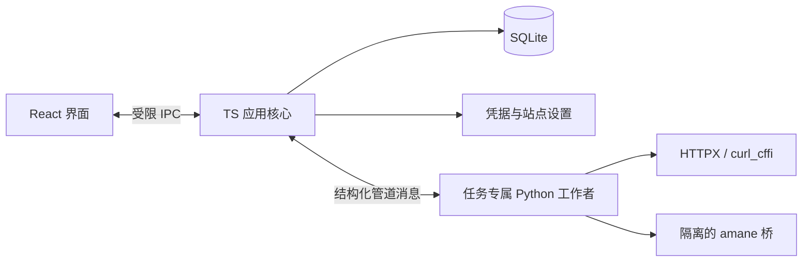

# Nectisse 产品与技术设计计划

- 整理日期：2026-10-23。
- 当前状态：来源体系扩展为 36 项配置，其中 24 个资料与 8 个订阅入口可派发（JavDB 同属两类），另 5 项保留前置条件登记。新增在线成功样本包含 AVBase、一本道、amane 的 S1、SubscribeStar 和 Kemono；JavDB 当前出口仍受地区限制。当前能力见第 13 节与 SOURCE_SUPPORT.md。
- 阶段边界更新：先完成分析、脚手架与四页模拟预览，再逐项接入资料与订阅能力，不整体搬入 Peach 后端。
- 第 8–11 节保留此前阶段的实现或设计记录；其中“尚未联网、无缓存”等描述只对应当时阶段。第 12 节与 README.md 记录当前状态。
- 订阅范围已追加确认：同时需要“创作者动态”和“演员新作”。第 11 节为设计，第 12 节记录本轮实现与验证边界。
- 产品名称使用 **Nectisse**，暂不绑定正式中文名。
- 参考项目：[Peach](https://github.com/peach-mitao/peach/tree/master)。
- 本地参考源码：`ref/peach/`，版本声明为 **0.46.1**。以下结论针对本地快照，不宣称与远端最新版本一致。

本文区分三类结论：

- **源码事实**：当前本地源码、配置、说明或已有测试用例能确认的行为。
- **设计建议**：面向 Nectisse 提出的方案，等待确认。
- **待验证**：需要在设计确认后的验证阶段解决。已有代码不代表已在新应用或当前站点上跑通。

初始分析已阅读 Peach 的 `AGENTS.md`、`CLAUDE.md`、相关说明、连接器和界面实现；当时没有安装依赖、启动 Peach、运行测试或执行在线采集。后续环境与来源验证分别列在第 8、10 节。Peach 界面参考结论来自实际实现，不属于运行后的视觉实测。

## 1. 产品目标、范围和主要使用流程

### 1.1 产品定位

**私人作品档案与创作者更新收件箱。**

作品资料和封面围绕作品组织，更新围绕创作者的站点身份组织。封面是作品档案的一部分；动态可以关联作品，但作品和动态不能直接混为同一种记录。

品牌气质是私人、安静、略带暧昧，具有作品档案与视觉收藏的感觉。封面和创作者内容是主角，界面保持清楚、易用。

### 1.2 三项核心能力

| 能力 | 功能范围 |
| --- | --- |
| 作品资料采集 | 按作品编号、标题或原站链接查询；获取来源实际提供的标题、人物、创作者、厂牌、系列、发行日期、标签、简介等字段；保留来源、原文链接和获取时间；处理冲突、优先级与手动修正 |
| 封面采集 | 展示可取得的候选；预览、比较、选择、本地缓存和导出；保存来源、尺寸、格式与核验信息；复用身份匹配和封面筛选规则 |
| 创作者更新 | 添加主页或站点身份并关注；手动刷新及按设置的频率检查；展示实际取得的标题、摘要、封面、作者、发布时间和原文链接；处理增量、分页、重复条目与已读状态 |

资料查询属于范围内功能，不与下载资源搜索混淆。封面缓存和导出不属于视频或资源下载。

动态收录依据是“创作者发布新动态”，不以是否交付附件、网盘链接或其他资源作为前提。公告和进度更新同样属于收录对象。

### 1.3 明确排除

- 视频及资源下载。
- 下载资源搜索、磁力与网盘下载任务。
- 本地磁盘扫描、媒体文件整理。
- 播放器、转码。
- 浏览器历史和口味分析。

以上能力不进入页面、任务类型与依赖提取范围。资料采集不能依赖磁盘遍历。

### 1.4 主要流程

| 流程 | 用户操作 | 应用结果 |
| --- | --- | --- |
| 建立作品档案 | 输入编号、标题或原站链接 → 确认作品身份 → 查看资料与来源 → 保存 | 得到可手动修正、可追溯来源的档案 |
| 收集封面 | 查看候选 → 预览比较 → 选择封面 → 按需导出 | 保存选定原图、来源和尺寸，保留其他候选 |
| 关注创作者 | 添加主页或站点身份 → 确认作者 → 关注 → 检查更新 → 阅读动态 | 获得有范围、有检查记录的更新流 |

作品资料中的人物、导演、卖家、厂牌和发布账号保留各自角色。演员名字不能自动变成可关注的创作者账号，平台也不能自动当作作者。

来源没有提供真实创作者主页时，允许用户另行添加主页并确认关联；不根据名字猜测账号归属。

首版应形成“查询资料与封面 → 保存档案 → 关注创作者 → 查看新增动态”的完整使用流程。

### 1.5 输入能力的现有缺口

**源码事实：**现有资料连接器主要围绕编号工作。源码中的 `search()` 多用于按编号定位详情页，并非已经支持任意标题搜索。例如 DMM 实现将编号拆成字母段和数字段后搜索，再核对商品身份。

**设计建议：**标题查询保留在首版需求中，新增“标题 → 候选作品 → 确认身份”的适配。不能拿已保存档案的本地搜索替代联网标题查询。原站链接也需要统一的输入识别与分派层，不能宣称任意网址均可采集。

依据：[DMM 搜索实现](ref/peach/src/peach/sources/dmm.py)。

## 2. Peach 可复用能力、依赖与站点支持矩阵

本节表示源码中存在的能力。本轮未验证站点当前可访问性，所有来源也都尚未在 Nectisse 中独立验证。

### 2.1 Peach 自身实现的资料连接器

| 来源 | 源码可确认的主要能力 | 身份、登录与网络条件 |
| --- | --- | --- |
| r18.dev | 编号查询；标题、人物、厂牌、系列、日期、标签、封面等 | 官方目录镜像；HTTP 请求，无需 Cookie |
| DMM / FANZA | GraphQL 查询；标题、人物、厂牌、系列、导演、日期、标签、简介、封面等 | 当前实现不带 Cookie；接口与地区行为需重新验证 |
| 一本道 | 官方作品 JSON、人物、简介、日期、标签及作品图片 | 日期式编号必须有发行方身份依据，避免同号串片 |
| FC2 | 商品资料、简介、卖家、日期、标签、封面 | 当前实现免登录；官方商品页不提供演员栏 |
| FC2CMADB | FC2 镜像资料、原图地址、人物与别名证据 | 支持 Cookie；人物栏存在额外的 Inertia 请求 |
| FC2PPV-DB | 标题、人物、卖家、日期、标签等 | 不提供封面；已有浏览器验证路径，也可尝试 Cookie 路径 |
| JAVten | 标题、卖家、日期、标签、FC2 图片地址等 | 已有浏览器验证路径；没有演员栏 |
| JavArchive | 搜索与详情、标题、部分日期/标签、转存图片 | 不需凭据；图片可能混入截图、动图等 |
| AVBase | 作品及商品条目、人物、厂牌、系列、日期、图片 | 当前实现不给时长；识别 Cloudflare 验证页 |
| JavBus | 作品资料与封面 | Cookie 用于年龄门；资料结算中设为兜底来源 |
| JavDB | 作品资料、人物、标签和封面核验材料 | 支持 Cookie；有站点间隔和冷却；图片不作为正式封面 |
| Seesaa：`sougouwiki`、`av_neme`、`av_name` | 精确编号的作品表、出演证据 | 独立 Wiki 查询与缓存路径；不在默认资料链上 |
| K-MIB | 官方页面的作品、人物和封面解析 | 独立快照解析与采集脚本，没有接入默认按编号查询链 |

依据：

- [直接连接器登记](ref/peach/src/peach/sources/__init__.py)。
- [站点配置、记录与失败契约](ref/peach/src/peach/sources/base.py)。
- [K-MIB 解析](ref/peach/src/peach/metadata_kmib.py)与[采集脚本](ref/peach/scripts/harvest_kmib.py)。

封面还有专用路径，需要与“完整资料站支持”分开记录：

- **DMM CDN**：根据已确认的商品身份生成新旧图片路径，再实测尺寸。
- **MGS、Prestige**：`jav_cover_fetch.py` 存在直接获取图片的实现；完整资料的默认归属则是 amane 桥。
- **DUGA**：当前封面流程主要复用已有成功记录的精确图片 URL；不能据此宣称已接入通用 DUGA 搜索。批量搜索 API 需要额外应用身份。

### 2.2 经 amane 桥接的资料来源

| Peach 实际开放的来源 | 能力与限制 |
| --- | --- |
| `makers` | 按编号前缀路由片商官网；桥说明称覆盖 29 家，本地未附上游完整源码，本轮未逐家核验 |
| Prestige、FALENO、DAHLIA | 官方资料；存在厂牌路由、地区及访问限制 |
| MGStage | 素人作品的主要官方资料来源 |
| AVSOX | 无码资料的后备社区来源 |
| FC2Club、FreeJavBT、AIRAV | 已有桥接，但默认资料链未普遍启用，部分仅通过显式覆盖点名 |

Peach 侧实际开放的是上述 **9 个来源键**。`bridge.py` 认识更多上游模块，不代表它们全部已经接入或可以独立使用。

当前桥固定到 amane **0.20.0** 的指定 revision：`cc42cee6ecf290cf05af1caa347d2dc2d5aeffcd`，不随运行自动更新。

`metadata_policy.py` 还保留了 Libredmm、TokyoHot、Caribbeancom、AVEntertainment、DLGetchu、Javlibrary、Jav321、Javstash 等历史来源身份。历史来源登记不能当作当前连接器支持清单。

日期字段需要保持语义：Prestige 桥接结果中的配信开始日单独记为 `delivery_date`，不直接当成发行日。

依据：[Peach 侧桥接与字段映射](ref/peach/src/peach/metadata_amane.py)、[桥脚本](ref/peach/tools/amane-bridge/bridge.py)、[依赖清单](ref/peach/tools/amane-bridge/pyproject.toml)、[锁文件](ref/peach/tools/amane-bridge/uv.lock)。

### 2.3 创作者更新连接器

| 来源 | 当前追踪对象与分页 | 需要调整或保留的边界 |
| --- | --- | --- |
| FANBOX | 创作者；真实游标分页 | 当前过滤付费/受限帖子；详情使用 `curl_cffi` 的 `chrome150` 指纹，Cookie 可选 |
| Patreon | 公开创作者页的帖子卡片 | 不支持历史分页；部分时间为估算；不能承诺摘要、作者和封面总能取得 |
| SubscribeStar `.com` / `.adult` | 公开创作者页 | 不支持历史分页；两个主机的同名账号不能自动合并 |
| Kemono、Pawchive、Coomer | 归档站的服务/用户身份；偏移分页 | 当前有“交付资源”过滤；归档更新不等于原作者实时发布 |
| Rule34Video | 模特/作者关联页；支持分页 | 站内身份不必然等于原创作者，需要核验署名关系 |
| Rule34.xxx | 标签查询；支持分页 | 需要 `user_id` 与 API key；标签不天然构成创作者身份 |
| Rule34 Paheal | 标签页及详情；支持分页 | 可取原始出处，但标签页不能直接当作作者主页 |
| F95zone | 论坛线程，主要读取最新回复 | 当前按资源过滤楼层，回复可能来自其他用户 |
| SimpCity | 论坛线程，读取末页 | 需要登录 Cookie；过滤纯文本讨论，不能直接作为作者动态流 |
| Gofile | 文件链接展开 | 登记为媒体来源，不是创作者追更来源；Nectisse 不提取 |

依据：[来源登记](ref/peach/src/peach/follow_providers.py)、[连接器实现](ref/peach/src/peach/follow_sources.py)、[凭据说明](ref/peach/src/peach/follow_secrets.py)。

### 2.4 动态收录规则的差异

**源码事实：**

- Kemono 系通过附件或资源链接判断是否交付资源；无资源的帖子可能被丢弃。
- F95zone、SimpCity 存在基于资源的楼层过滤。
- FANBOX 明确跳过付费或受限帖子。
- 部分连接器的详情补全会进一步展开文件站、媒体清单或播放信息。

**Nectisse 设计建议：**

- 收录条件改为：确认属于所关注创作者的一次发布，且来源实际返回可展示的信息。
- 公告、进度、纯文本动态不能因没有资源被排除。
- 同时移除资源展开、媒体探测等后续调用，不能只删除一个过滤判断。
- 论坛和标签站需要重新建立创作者身份判断，不能把全部回复或标签命中当作作者发布。
- 受限帖子若公开返回标题、封面等信息，可记录公开部分并标为“正文受限”。未返回的信息保持未取得。
- 不承诺来源没有提供或当前无法取得的内容。

### 2.5 模块提取与依赖清单

| 能力 | 提取重点 | 迁移边界 |
| --- | --- | --- |
| 作品身份与来源路由 | `catalog_rules`、`metadata_routes`、`sources` | 接受用户输入和来源证据，去除媒体路径、文件名依赖 |
| 字段优先级 | `metadata_policy` | 保留字段级规则与来源追溯，改为 Nectisse 的数据结算 |
| 封面发现与核验 | `jav_cover_fetch`、`community_catalog` | 提取候选生成、身份核验、尺寸和图像比较，不调用批量扫描入口 |
| 创作者资料与帖子解析 | `follow_sources`、URL 规范化与部分身份逻辑 | 删除资源解析、播放信息和文件站展开 |
| 网络传输 | `http`、`browser_transport`、编码与重定向规则 | 保留不同传输类型，接入统一预算与取消机制 |
| 调度 | `follow_scheduler` 的退避、去重执行等思路 | 调度迁到 TS，不保留另一套 APScheduler |
| 凭据 | `follow_secrets` 的域隔离与脱敏原则 | TS 集中管理，采用 macOS 密钥存储支持的方案 |

直接采集的主要 Python 依赖是 **HTTPX、BeautifulSoup、Pillow、curl_cffi**；部分图片互证使用 **OpenCV 与 NumPy**。

amane 的锁文件包含更广的依赖，其导入会牵入 SQLAlchemy 等模块。不能未经验证就按“只用爬虫”随意删包，也不需要因此运行一个数据库服务。核心环境与桥的依赖版本存在差异，需在构建阶段隔离或验证兼容性。

`library_processing.py` 同时导入扫描、NFO、媒体探测和 FFmpeg 等模块，不适合整体引入。即使只调用其中的资料方法，也可能把无关依赖带进来。

许可事实应进入依赖登记：Peach 声明 **AGPL-3.0-or-later**，amane 桥声明上游为 **GPL-3.0**。具体分发与源码提供方案待确定，独立产品结构不能代替依赖许可评估。

### 2.6 资料结算规则

Peach 已区分“请求哪个来源”与“字段冲突时采用谁的结果”。现有策略包含官方来源、JavDB、其他社区来源、JavBus 兜底，以及 FC2 人物字段的特殊优先级。

Nectisse 建议继承这些规则的依据，保留字段级来源优先级、例外和策略版本；不继承本地 NFO 优先层。手动修正与来源采用值分开记录，用户锁定的字段不被刷新覆盖。

依据：[来源路由](ref/peach/src/peach/metadata_routes.py)、[来源策略](ref/peach/src/peach/metadata_policy.py)。

### 2.7 封面身份与筛选规则

**源码事实：**

- 先核对作品身份，包括编号字母、数字、商品 ID 和图片 URL，避免取到相近编号或合集封面。
- 高质量封面的常用宽度门槛为 **700 px**；采集流程另允许 **240 px** 起的官方小图回退。
- 可先读取最多 **64 KiB** 图片头探测尺寸，完整取得后再验证解码和尺寸。
- 候选按实际图片质量与像素面积比较，同尺寸时考虑商品图等图片角色；不是固定主机优先级。
- 多图源通过 dHash、比例和可选 ORB 特征匹配互证。
- 当前代码也允许单图源回退，此时 `verified_by` 为空，不能显示为已互证。
- JavDB 图片只用于核验，不作为正式封面。
- 原图保留，展示取景与原图文件分开。

**Nectisse 设计建议：**分别记录身份可信程度、图片角色和像素质量。大图不等于正确封面，截图不能仅因清晰就胜出。未互证候选可供用户检查；已明确串片、占位图和损坏图片不进入可选择列表。

候选收集需要独立接口，不能只复用返回最终胜出图片的函数，否则无法支持比较与手动选择。

依据：[封面发现与身份排错](ref/peach/src/peach/jav_cover_fetch.py)、[图源互证与单源回退](ref/peach/src/peach/community_catalog.py)、[资料与封面编排](ref/peach/src/peach/library_processing.py)。

## 3. TS 与 Python 的职责、通信和进程生命周期

### 3.1 技术方向

- Electron。
- React + TypeScript。
- Tailwind CSS。
- shadcn/ui。
- 随 App 打包的 Python 运行时、依赖与采集脚本。

优先由 TS 承担界面、应用控制、数据管理和任务调度；Python 用于复用站点连接器、身份与封面核验，以及难以直接替代的网络传输和解析能力。

### 3.2 通信方案

建议首版选择**标准输入输出上的结构化消息协议**，暂不建立本机 HTTP 服务。

| 方案 | 对本项目的判断 |
| --- | --- |
| 本机 HTTP | FastAPI 能承载，但要管理端口、鉴权、就绪状态和服务残留；现有路由与完整 Peach 应用耦合 |
| 进程通信 | 已有 amane 桥提供“一次进程、结构化结果”的参考；更容易绑定任务、检测退出并终止对应工作者，符合桌面应用范围 |

| 层 | 职责 |
| --- | --- |
| React | 页面、表单、预览比较、任务状态；不直接读数据库或持有 Cookie |
| TS 应用核心 | 作品保存、字段结算、数据库、缓存索引、关注关系、已读状态、调度、限流、重试预算与进程监督 |
| Python | 站点解析、既有身份核验、特殊传输、图像核验与 amane 调用 |

复杂数据库或文件操作放在 TS 工作线程或独立工作进程，避免阻塞主窗口。站点规则应有唯一归属和版本，不在 TS、Python 两侧维护互相漂移的副本。

协议至少包含任务 ID、运行代次、来源、请求 ID、协议版本，以及进度、结果、错误和取消确认。图片通过受控临时文件传递，消息只传路径、哈希和元信息；标准输出专供协议，日志经脱敏后进入独立通道。

### 3.3 内置运行环境与分发

- Electron、Python 解释器、采集代码与锁定依赖在构建时准备，随 `.app` 分发。
- 核心采集环境与 amane 依赖环境可以隔离，共享同一版本的内置 Python 运行时。
- 不沿用 Peach 当前“运行时寻找 uv、下载并重建 amane venv”的流程。
- 首次启动不执行 `pip install`，不下载解释器，不要求安装 Python、Node.js、uv 或其他开发工具。
- 分架构核验 Python、`curl_cffi`、Pillow、OpenCV 等原生组件及动态库。
- 验证签名后的完整 App；对外分发需要准备签名、公证流程。
- 程序资源只读，数据、凭据和缓存均写入应用数据目录。

参考：[Electron 签名与公证](https://www.electronjs.org/docs/latest/tutorial/code-signing)。

### 3.4 进程生命周期

1. 启动时先取得单实例锁，再显示主窗口。
2. 本地界面与已保存内容先可用，后台检查运行时并启动工作者。
3. 再次双击或点击 Dock，恢复已有窗口，不创建第二套后台。
4. 关闭窗口后，应用继续运行并按设置检查更新；首次关闭时说明该行为。菜单提供明确的“退出 Nectisse”。
5. `⌘Q` 停止调度，结束本应用管理的任务、桥接与浏览器进程，再退出。
6. Python 检测父进程通信断开并退出；异常关闭后的残留由进程监督机制处理。

只管理本应用创建的进程及进程组，不按进程名批量终止其他 Python 或浏览器实例。工作者的桥接子进程也必须纳入生命周期，不能只结束最外层进程。

参考：[Electron 单实例锁与 macOS 激活事件](https://www.electronjs.org/docs/latest/api/app)。

### 3.5 浏览器验证与特殊指纹

**源码事实：**Peach 会启动已安装的 Chrome/Edge，使用独立 profile，通过导航与 CDP 读回页面。它依赖真实浏览器环境、Cookie、User-Agent 与出口的一致性，不是简单地调用页面内 `fetch()`。

FANBOX 详情使用 `curl_cffi` 的 TLS/HTTP2 指纹能力；普通 `fetch` 不是等价替代。JavDB 的限流也不能默认靠更换指纹解决。

**待验证：**隔离的 Electron 登录窗口是否足以替代具体站点的原浏览器流程。不能因为 Electron 内置 Chromium 就预先宣布替代成功。

基础流程不能依赖用户额外安装 Chrome；需要该能力的来源在验证通过后再开放，外部浏览器方案只能作为另行明确的可选路径。

依据：[HTTP 传输](ref/peach/src/peach/http.py)、[浏览器流程](ref/peach/src/peach/browser_transport.py)、[来源传输与冷却](ref/peach/src/peach/scraping_access.py)。

## 4. 本地数据模型与缓存策略

### 4.1 数据模型

建议使用 SQLite，由 TS 单一写入入口管理。数据模型不包含媒体文件路径、扫描目录和下载任务。

| 数据对象 | 主要内容 |
| --- | --- |
| `work`、`work_identifier` | 作品档案；发行体系、规范编号、站点商品 ID、原始写法与版次 |
| `entity`、`work_credit` | 人物、创作者、厂牌、系列及其作品关系；明确出演、导演、发布者、卖家等角色 |
| `source_record` | 来源、原文链接、获取时间、解析器版本、结构化资料与完整/部分取得状态 |
| `field_candidate`、`field_selection` | 字段候选、来源证据、当前采用值、手动修正与锁定状态 |
| `cover_candidate`、`image_blob` | 图片来源、角色、尺寸、格式、哈希、身份核验、互证信息与本地文件 |
| `creator_identity`、`follow` | 创作者与站点账号；关注状态、检查频率、游标与覆盖范围 |
| `update_item`、`read_state` | 站内帖子 ID、标题、摘要、作者、封面、发布时间及精度、原文链接与已读状态 |
| `task`、`task_step`、`source_state` | 任务范围、预算、进度、终态、取消时间、失败、冷却与恢复记录 |

### 4.2 身份、字段与时间规则

- 作品身份使用“发行体系＋编号/商品身份”，不能只用一段编号文本。
- 帖子使用“来源账号＋站内帖子 ID”去重，不按标题去重。
- 跨站同名账号不自动合并；跨站动态只有存在原始帖子 ID、明确出处等证据时才关联。
- 来源数据、采用值和手动修改分开存。刷新不覆盖用户锁定的值，允许恢复来源采用方式。
- 列表阶段没返回的字段，不清空此前从详情取得的内容。字段缺失与来源明确给出的空值需要区分。
- 发行日、配信日、帖子发布时间和首次发现时间分开。缺发布时间时显示“发布时间未取得”，不把获取时间伪装成发布日期。
- 现有 amane 映射会过滤部分人物并压缩某些列表字段；Nectisse 按角色保留来源实际提供的资料，不直接沿用该投影。

### 4.3 数据目录与缓存

应用数据位于 `app.getPath('userData')` 下的专用子目录；macOS 默认对应 `~/Library/Application Support/Nectisse/`。`.app` 内只放只读程序资源。

| 类型 | 建议策略 |
| --- | --- |
| 已选封面原图、已保存档案 | 作为用户数据保留，不参与普通 LRU 清理 |
| 候选预览、缩略图、临时响应 | 可调整容量，按 LRU 清理；失败临时文件自动回收 |
| 资料快照 | 保存获取时间和版本；过期时可先展示已有资料，再明确刷新 |
| 明确未找到 | 按来源、身份与解析器版本短期缓存；近期新作采用更短期限 |
| 登录、限流、网络、解析错误 | 不记成“作品不存在”，分别进入凭据状态或失败退避 |

选定原图按内容哈希存放，避免重复文件。导出通过原生保存面板复制选定文件，保留正确格式；裁切预览不修改原图。清理缓存不删除手动修正、关注关系或选定封面。

Peach 现有按来源记录明确缺失、来源阵容变化后重新判断缓存有效性的思路可以复用。具体容量和 TTL 在实现阶段根据样本确定，不将瞬时失败固化为长期缺失。

参考：[Electron 数据目录](https://www.electronjs.org/docs/latest/api/app)、[Peach 缺失缓存](ref/peach/src/peach/library_processing.py)。

### 4.4 凭据与日志

- Cookie、API key 和代理密码由 TS 集中管理，采用 macOS 密钥存储支持的加密方式。
- Python 只获取当前任务所需凭据，不通过命令行参数传递。
- 凭据按站点和账号隔离，不因跨站重定向泄露 Cookie 或 Authorization。
- 日志、诊断与缓存 URL 删除敏感查询参数；对 API key 必须放进请求参数的来源尤其如此。
- 登录状态、Cookie 与代理设置在同一入口管理，UI 状态与实际使用的凭据保持一致。
- 正文和原始响应按必要性保存，不将含凭据的请求头混入普通快照。

参考：[Electron safeStorage](https://www.electronjs.org/docs/latest/api/safe-storage)、[Peach 凭据管理](ref/peach/src/peach/follow_secrets.py)。

## 5. 页面结构、导航与关键布局

### 5.1 来自真实实现的参考结论

已阅读 Peach 的卡片、作品详情、实体资料卡和关注流实现。以下是源码确认，不是截图测量或运行后的视觉验收。

| Peach 已有实现 | Nectisse 建议 | 目的 |
| --- | --- | --- |
| 作品卡以图片为主，标题折叠、身份和来源辅助识别 | 保留封面主导的卡片，重点显示编号、标题和资料状态 | 快速辨认作品 |
| 详情采用大图与资料侧栏 | 封面展示＋档案资料，增加字段来源与修正入口 | 支持资料收藏和核对 |
| 实体资料卡集中头像、名字、别名、外链 | 创作者页集中身份、站点账号、关注和检查状态 | 明确关注对象 |
| 关注流有作者筛选、图片网格、检查更新和历史页入口 | 默认按发布时间阅读，允许无图动态，历史获取单独操作 | 让公告和进度同样可见 |

依据：[卡片样式](ref/peach/frontend/src/react/components/media-card.css)、[作品详情](ref/peach/frontend/src/react/jav-detail/jav-detail-page.tsx)、[创作者资料卡](ref/peach/frontend/src/react/entity-hero/entity-hero-page.tsx)、[关注流](ref/peach/frontend/src/react/follow-feed/follow-feed-page.tsx)。

### 5.2 导航

| 页面 | 内容 |
| --- | --- |
| 资料查询 | 输入编号、标题或链接，查看候选与查询进度 |
| 作品档案 | 已保存作品；按编号、人物、厂牌、系列和标签筛选 |
| 更新 | 所关注创作者的新动态、未读和来源状态 |
| 创作者 | 已关注作者、站点身份、检查频率和单作者动态 |
| 底部：任务、设置 | 任务记录；来源与登录、网络、缓存、后台行为 |

封面位于作品详情内，不另设割裂的一级封面库。不照搬 Peach 的完整导航与设置。

### 5.3 关键页面

- **资料查询**：顶部输入框和来源范围；下方先显示作品候选，再进入资料结果。标题查询不能直接跳到“唯一正确作品”。操作使用“查询资料”“补充资料”“查找封面”。
- **作品详情**：左侧封面，右侧编号、标题、人物与主要资料；下方使用“资料 / 封面 / 来源”页签。字段旁可展开来源与备选值。
- **封面比较**：候选带尺寸、来源、图片角色和核验状态；支持两张并排、原尺寸查看；分别提供“设为封面”和“导出”。
- **创作者主页**：头像、姓名、站点账号、关注状态、最近检查与下一次检查；主体展示动态。
- **更新流**：默认使用可阅读的图文列表。无封面的公告使用文本布局，不以缺图判断条目无效。打开动态或明确操作后标为已读，不因滚过列表就静默已读。
- **任务面板**：显示操作对象、来源、当前阶段、已取得内容、取消按钮和问题详情。关闭面板只收起展示。

### 5.4 视觉方向

| 方向 | 色彩分工 | 适合表达 |
| --- | --- | --- |
| 奶油档案 | 奶油白内容面、暖灰结构、黑莓紫选中态，少量蜜桃提示 | 清楚、安静，适合长时间整理资料 |
| 黑莓夜间 | 深黑莓与暖深灰底、柔白文字，蜜桃色用于小面积强调 | 私人收藏和封面浏览 |

建议先以奶油档案验证信息密度，再做对应深色主题，暂不锁定色值。封面周围保持中性，品牌色主要进入导航、焦点和操作状态。

组件优先复用 shadcn/ui 的 Sidebar、Tabs、Dialog、Sheet、Popover、Command、Select、Tooltip、Alert 等。字号、间距、圆角和状态色统一成少量 token；保留键盘操作、清晰焦点与减少动态效果支持。

## 6. 采集、刷新、取消、失败与恢复的交互

### 6.1 启动与后台状态

主窗口先出现，再依次显示“正在准备采集环境”“可以采集”或具体故障。Python 启动失败时，已保存档案仍可浏览，提供重试和脱敏诊断。

冷启动窗口出现时间以 **2 秒内**作为初始性能目标，最终需在约定设备上实测。

关闭窗口、后台运行和退出应用分别呈现。应用退出、系统休眠时不承诺继续检查。唤醒后合并错过的周期，只安排一次到期检查，避免集中补跑。

### 6.2 范围与预算

每个任务创建时冻结范围，显示“这部作品”“这个创作者”“选中的 3 个来源”等明确对象。

建议初始默认值：

- 添加创作者：获取最近约 20 条，最多检查 3 页，不自动补满全部历史。
- 常规刷新：从最新页开始，有重叠地向后检查；碰到已知边界或达到页数、请求数、时间上限即停止。
- 达到上限仍未碰到旧边界：标为“本次检查未覆盖全部新增”，提供继续检查。
- 获取更早动态：单独按钮，一次一页或明确的一段日期范围。
- 不支持分页的来源：明确显示“仅检查公开首页”，不宣称覆盖离线期间的全部更新。
- 明确区分列表刷新、资料重新采集和封面重新探测，防止一个轻操作隐式扩大请求范围。

调度考虑站点和出口，共享站点间隔、并发数、超时、字节与重试预算。Peach 默认约 2 秒间隔、JavDB 约 3 秒可作为初始参考，实际策略需重新验证。

amane 内部重试也必须计入同一预算，不能在外层限流后自行放大请求。需要验证桥的传输适配能否统一接入许可与计数；未接入前不能宣称已经实现全链路站点限流。

自动检查建议默认每小时，可按创作者调整，站点限制优先。手动刷新和定时刷新遇到同一对象时合并执行。取消某一轮刷新与关闭未来自动检查是两个操作。

### 6.3 真正取消

**源码事实：**Peach 包含线程状态和检查停点，但同步 HTTP、退避等待与桥接调用不能直接视为满足本次取消要求。

**设计建议：**任务使用专属 Python 工作者，按以下顺序处理取消：

1. TS 持久化取消意图，任务进入“正在取消”。
2. 停止派发请求、翻页和重试，撤销该运行代次的结果写入权限。
3. 通知 Python 停止，取消等待并关闭可中止的连接和页面操作。
4. 短暂宽限后仍未结束，终止该任务工作者及其管理的桥接子进程。
5. 确认进程结束和临时文件处理完成后，持久化为“已取消”。

已完成并提交的资料可以保留；未完成页不推进完成游标。取消后的迟到结果不能写入。服务器已收到的请求无法撤回，但应用必须终止本地在途工作并停止后续请求。

**已取消任务在重启后保持终态。** 用户再次点击刷新会创建新任务；未来定时周期也属于新任务，不是恢复被取消的那一轮。

依据：[当前任务停止实现](ref/peach/src/peach/jobs.py)、[关注检查与停点](ref/peach/src/peach/web_follow.py)、[连接器请求和退避](ref/peach/src/peach/follow_sources.py)。

### 6.4 错误呈现

| 情况 | 界面表现与处理 |
| --- | --- |
| 明确登录失效或登录页 | “需要重新登录”，定位到对应来源 |
| 裸 403、无法确定原因 | “访问被拒绝”，不直接断言 Cookie 过期 |
| 429 / 来源限流 | 显示冷却及下次可检查时间，停止该来源派发 |
| 浏览器验证 | “需要完成站点验证”，关联到验证窗口 |
| 页面结构不符 | “解析失败”，保留旧资料与诊断，不显示为没有作品 |
| 部分来源成功 | 展示已取得资料，并列出未完成来源 |
| 图片失败 | 保留当前封面，允许重试候选，不显示损坏图片 |
| 应用或工作者崩溃 | 标记“意外中断”，展示已完成部分，允许继续或重试 |

### 6.5 恢复

- 恢复只处理未完成部分，重新经过站点冷却和预算检查。
- 已读状态、人工选择和已提交资料不回滚。
- 正常退出时未完成任务可标为中断；首版建议用户主动恢复，避免打开 App 就重启长任务。
- 启动时读取已持久化的取消意图，不能把取消中的旧任务重新放入运行队列。
- 某来源失败不阻止其他来源已成功结果可见，也不把已有资料清空。

## 7. 首版范围、后续阶段与验收标准

### 7.1 阶段划分

以下业务工作仍在用户确认设计后开展；其中随包运行环境与进程管理已单独获准提前验证，见第 8 节。

| 阶段 | 交付目标 |
| --- | --- |
| 独立能力验证 | 内置 Python 和原生依赖可运行；至少一个标题查询入口；FANBOX 指纹传输；真实取消和子进程清理；必要浏览器流程的可行性 |
| 首版 | 完成“查询资料与封面 → 保存档案 → 关注创作者 → 查看新增动态”的完整流程 |
| 后续 | 扩展已验证来源、复杂跨站身份关联、更多受限来源的可见信息适配、批量封面比较与导出 |

### 7.2 首版来源建议

- **资料基础**：r18.dev、DMM、FC2；JavDB 作为受限速控制的补充资料与核验来源。
- **官方扩展**：按需求优先验证 `makers`、MGStage、Prestige、FALENO、DAHLIA，逐个开放。
- **创作者更新**：FANBOX 作为具备分页的完整基准；Patreon、SubscribeStar 提供明确标注范围的公开首页适配。
- 归档站、标签站和论坛先保留分析结论，依据用户实际关注的来源调整优先级，不将它们都作为同等可靠的作者主页。

标题查询仍是首版验收项：至少一个已验证来源能按标题返回候选作品，再进行身份确认。若验证发现不可取得，需要明确调整设计，不能静默删除这一能力。

来源开放以独立运行、实际样本、异常行为和打包验证为依据，界面清单不把“代码存在”标成“已验证可用”。

### 7.3 可验证的验收标准

| 验收项 | 通过标准 |
| --- | --- |
| 独立启动 | 没有 Python、Node.js、uv 等开发环境的测试机器上，双击签名 App 可进入窗口并完成采集 |
| 单实例与退出 | 重复双击唤回窗口；退出后无本应用管理的 Python、桥接或浏览器残留 |
| 三种查询输入 | 编号、标题和支持的原站链接各有成功样本；歧义返回候选，不自动错配 |
| 资料追溯 | 每个采用字段可查看来源、原文链接与获取时间；刷新不覆盖锁定的手动修正 |
| 身份与封面 | 相近编号、同形日期编号、合集封面等反例不串片；未互证图片有明确标记 |
| 封面保存 | 可预览、比较、选择和导出；尺寸与实际文件一致；清缓存不删除选定原图 |
| 动态完整性 | 纯文本公告、进度更新和有封面的发布均可收录；受限内容只展示实际取得的字段 |
| 增量与分页 | 重复刷新不重复入库；分页重叠不漏边界；达到预算时显示覆盖不完整 |
| 已读 | 已读状态在刷新、重启和部分详情失败后保持；“全部已读”有明确作用范围 |
| 真正取消 | 请求中、退避中、翻页中和桥接中均可终止；不再派发请求；重启不恢复已取消任务 |
| 故障恢复 | 断网、429、登录失效、解析失败和工作者崩溃均有应用内状态，已有数据可用 |
| 范围与隐私 | 没有媒体扫描和资源任务；普通日志无 Cookie、token 和代理密码；数据不写入 `.app` |

测试使用隔离样本和临时数据。已有 Peach 测试用例可作为规则回归依据，本轮并未运行它们，也不能代替独立应用、真实传输和签名包验证。

### 7.4 待验证事项

- 任意标题查询的实际来源入口、候选字段和有界分页行为。
- 用户输入的原站链接如何映射到站点原生身份，以及歧义时的确认流程。
- 内置 Python、核心依赖和 amane 隔离环境在目标 Mac 架构中的独立运行。
- `curl_cffi` 指纹传输、超时和取消，以及签名后的原生依赖加载。
- Electron 隔离窗口能否替代具体站点的原 Chrome/Edge 验证路径。
- amane 内部请求与重试如何接入统一站点限流和预算。
- 来源当前实际返回的字段、访问限制和错误边界。
- 任务取消、异常退出、父进程退出后的子进程清理与持久化终态。
- 默认页数、检查频率、缓存容量、TTL 和启动性能的样本验证。
- 分发形式、许可登记、签名与公证方案。

### 7.5 需要用户确认的关键决策

1. **首版必须覆盖哪些创作者站点？** 默认建议 FANBOX 为完整基准，Patreon 和 SubscribeStar 提供公开首页适配；若归档站是主要需求，应调整顺序。
2. **应用仅自用还是准备对外分发，需要支持哪些 Mac 架构？** 这影响内置运行时产物、原生依赖验证、签名和分发安排。

确认设计前，业务页面与采集功能继续保持设计阶段；基础脚手架按用户追加授权推进。

## 8. 已授权的基础脚手架与验证边界

### 8.1 Python 是否必要

**评估结论：以最大程度复用 Peach 为目标，应保留 Python。** Electron 并非技术上必须搭配 Python；如果全部采用 TS，就需要重新实现并验证现有连接器、身份与封面规则、HTTPX/curl_cffi 传输以及 amane 桥，失去此次复用的主要收益。

不能用普通 `fetch` 直接替代 curl_cffi，也尚未证明 Electron Chromium 可以替代 Peach 的所有浏览器验证流程。选择 Python 是基于已有实现与验证成本，不是宣称 TS 无法联网或解析。

### 8.2 本轮落地范围

- Electron 主进程、隔离的 preload、React + TS、Tailwind CSS 与 shadcn/ui 基础组件。
- TS 管理单实例、窗口、应用退出和 Python 工作者；受限 IPC 不暴露任意命令执行。
- 使用锁定的随包 CPython 3.14.9、HTTPX 与 curl_cffi；构建时准备，应用启动时不安装依赖、不寻找系统 Python。
- 按任务建立 Python 工作者，使用有版本、ID 和大小限制的 NDJSON 管道消息；当前业务方法只有离线环境检查。检查完成即结束工作者，不常驻 HTTP 服务。
- 取消、超时、退出、宿主异常死亡时清理本应用创建的工作者与进程组。取消和阻塞操作仅通过独立测试方法验证，不暴露到桌面 IPC。
- 原样提取 Peach 的 `http.py`、`user_agent.py`、`catalog_rules.py`，保留许可证、来源与哈希。没有整体搬入 Peach 后端。
- 基础阶段的界面为导航和环境状态占位；随后按第 9 节授权接入四页模拟预览，原始视觉稿仍独立保留在 `design/nectisse-visual-v1/`。

### 8.3 验证与限制

基础验证覆盖原生模块加载、原文件完整性、重定向凭据隔离、有界响应、日文编码、近似编号、取消、超时、子进程及宿主异常退出。7 项 TS / 工作者测试和 6 项 Python 离线回归已通过；本机 arm64 桌面、打包搬移、单实例、窗口重开及启动失败重试也已通过。具体边界与记录见 [README.md](README.md)。

尚未接入实际站点、amane、浏览器验证、SQLite、凭据管理、缓存与持久化任务。尚未验证网络请求中的取消、重试预算、分页或重启后的取消终态；这些仍按第 6、7 节作为业务验收项。环境检查通过不等于某站点已可用。

本轮目标是本机 macOS arm64 开发产物；Intel、干净机器、签名与公证仍需单独验证，不能等同于可对外发布的首版。

## 9. App 内的模拟视觉预览

用户追加授权：先把既有视觉方案接入脚手架，以模拟数据展示资料查询、作品详情、创作者主页和更新流，确认布局与风格；暂不接真实站点。

### 9.1 已接入的展示

- 沿用 `design/nectisse-visual-v1/` 的暖灰侧栏、奶油内容面、黑莓紫操作色与生成摄影素材；适配真实 macOS 窗口，不绘制第二套窗口交通灯或稿外导航。
- 默认“奶油档案”，支持“黑莓夜间”；设置中可切换外观和还原演示状态。
- 资料查询使用三部虚构作品，支持本地示例筛选；点击不同候选打开各自资料和对应创作者。
- 详情页包含资料、封面和来源；可演示封面选择/比较、发行日期采用值与手动锁定、保存状态。
- 创作者主页展示正确的模拟账号、关联作品与动态；关注与频率只切换内存状态。
- 更新流展示图片、无图公告与进度动态；已读、创作者筛选和当前列表全部已读相互联动，不扩大标记范围。
- 预览代码集中在 `src/renderer/src/prototype/`；基础受限 IPC、单实例、进程退出机制保留。

### 9.2 演示边界

所有身份、资料、来源、URL、尺寸、核验结果和时间均为虚构。原文入口不打开真实地址；刷新、导出与频率设置不创建真实任务。应用不发送站点请求，Python 仅做此前的离线环境检查。

状态保存在当前窗口的 React 内存，重新加载或重开窗口后重置；没有真实关注、资料入库、Cookie 管理或任务持久化。侧栏“作品档案”直接进入当前作品详情预览，独立档案列表仍待后续设计与实现。

### 9.3 确认方式

从查询打开作品 → 比较封面或查看字段来源 → 进入对应创作者主页 → 在更新流阅读与筛选。切换两种外观、调整窗口尺寸后确认信息密度、层次与色彩。截图和运行说明见 [README.md](README.md)。

本机 arm64 的构建与 Electron 检查已通过；搬移后的打包副本也验证了四页、两种主题、1000×700 无横向溢出、封面/字段/关注/已读交互、无 HTTP/HTTPS 站点请求，以及启动失败提示与重试。截图保存在 `.test-output/development-visual/` 和 `.test-output/packaged-visual/`。这些是预览验证，不代表真实来源功能验收。

本轮只落实视觉预览；真实来源、amane、数据库、封面缓存、联网取消与调度的验收范围继续按前述章节执行，等待后续授权。

## 10. 关键资料连接器：当前实现

用户追加授权：“第一版先这样，先实现最关键的资料连接器。”本阶段保留视觉方向，优先打通编号 / 标题 / 原站链接 → 身份核对 → 来源资料 → 本地封面的路径。没有整体导入 Peach 后端，也没有接入视频、资源任务或媒体扫描。

### 10.1 来源与实际验证

| 来源 | 当前入口 | 实际字段与边界 | 2026-10-23 本机结果 |
| --- | --- | --- | --- |
| DMM / FANZA | 编号；关键词搜索最多展开 3 个候选；可识别原生 CID 的商品链接 | 标题、出演人物、导演、厂牌、品牌、系列、发行日、标签、简介、商品身份与封面；具体字段可空 | `SSIS-057` 资料与 2184×1468 封面成功；关键词入口返回 3 个已核身份候选 |
| r18.dev | 编号、dvd_id / combined 作品链接 | 原始 JSON + 日文 combined；日文失败时保留实际英文标题并标记语言；不编造人物 | `SSIS-057` 两份资料与 800×538 封面成功；已兼容当前 jacket_image 对象及空格候选 |
| FC2 官方商品页 | 完整 FC2-PPV 编号、article 商品链接 | JSON-LD / DOM 解析；卖家与出演人物分开，拒收分段编号与不一致 SKU | 本地夹具通过；旧编号及首页展示的样本商品均返回 HTTP 404，尚无在线成功样本，界面标明待验证 |

这三条来源使用 Peach 原有 HTTPX 路径，不需要为了本轮改成 fetch 或浏览器。curl_cffi 保留原模块及随包依赖，但不宣称本轮已验证需要特殊指纹的站点。Cookie、登录、验证窗口、amane、JavDB 与创作者来源尚未接入。

提取方式与哈希见 `python/vendor/UPSTREAM.md`、`python/vendor/metadata-extraction.json`。Nectisse 为来源提供最小 Session / SiteRecord 契约。DMM 在 Peach 规则上额外拒绝“CID 与 makerContentId 一项命中、另一项冲突”的资料；不因通用身份函数的任一命中规则收下错片。

### 10.2 应用分工与可见行为

- 默认进入真实资料查询，启动不自动联网；“视觉演示”保留原四页。创作者、更新、作品档案侧栏页仍为模拟内容。
- TS 校验输入、选择来源、解析系统代理、控制请求许可、状态持久化和封面缓存；Python 复用来源解析、身份规则、HTTPS 传输与图片解码。没有本机 HTTP 服务器或固定监听端口。
- 每个查询结果保留完整的各来源规范化字段、原生身份、解析器版本、原文链接与获取时间。按 DMM → r18.dev 取首个非空显示值，差异页保留来源原值；暂未建立手动修正与正式档案保存。
- 来源链接只由主进程从已保存来源记录打开；封面经验证后通过受限 `nectisse-cover://image/<sha256>` 协议读取本地缓存。渲染进程不直接请求站点图片。
- 每条来源记录自动尝试第一张来源封面；复用跨作品 URL 排除与尺寸阈值，再校验静态格式、完整解码、实际尺寸、像素和字节上限。标为“来源匹配，未互证”，未实现完整图片互证、裁剪、手动选定原图或导出。

### 10.3 有界调度、取消和数据

- 单个活动查询；编号只访问相应类型来源，标题只访问 DMM；无历史抓取、分页循环或自动重试。
- 每站请求间隔至少 2 秒，包含重定向与封面；单工作者最多 8 次请求 / 45 秒调度预算，连接与读取超时最多 12 秒，单工作者由宿主在 60 秒终止。整项查询最多 24 次请求。
- 429 结合 Retry-After 冷却至少 60 秒；拒绝访问 / 登录 / 浏览器验证冷却 5 分钟，网络、超时、服务故障退避 30 秒。冷却状态跨重启保留。
- 使用 Electron 解析的系统代理，不继承宿主代理环境变量；代理仅通过私有工作者管道传递，不放进日志、界面或资料记录。代理认证目前不支持。代理解析、域名与 HTTPS 边界不等于复现原浏览器验证。
- HTTP 状态、验证页面、解析异常与部分结果分别展示。取消先持久化意图，再中断工作者；排队许可可取消，在途请求通过终止本应用工作者及其进程组收尾，迟到结果不提交。
- 普通退出和意外恢复均不会自动续跑；运行中的旧任务标为中断，已写取消意图的旧任务标为取消。
- 用户目录内 `metadata/state.json` 原子保存最近 20 项查询和来源快照；相同查询 1 小时复用结果，强制刷新仍受冷却约束。当前是有界查询记录，不是最终 SQLite 档案库。
- `cache/covers/` 按 SHA-256 保存原始封面，预算 128 MiB；临时文件单独管理，清理范围仅限本应用缓存。用户数据不写入 `.app`。

### 10.4 验证与下一步

当前回归包含 14 项 TS / 工作者测试、14 项 Python 离线测试；覆盖来源隔离、错片、日文和原字段、FC2 卖家角色、重定向、解码、取消落盘、拒绝迟到结果、冷却与重启。真实桌面验证覆盖查询、两份来源详情、本地封面协议、主题、最小窗口和取消操作。具体构建与验收结果以 README.md 为准。

arm64 开发包已更新；搬移后的副本通过了来源链接查询、真实封面、取消状态、单实例、窗口重开和启动故障恢复，并确认使用包内解释器。

当前只验证 macOS arm64 本机开发包。FC2 在线成功、受限来源凭据与指纹、amane、手动字段与正式档案、全量封面导出、创作者更新、SQLite、Intel / 干净机器、签名与公证仍待后续实施或验证。本轮连接器完成不等于第 7 节完整首版验收完成。

## 11. 正式设置、来源与两类订阅

用户确认需要同时覆盖 **创作者动态 + 演员新作**。两者共用来源配置、任务与更新入口，但保留各自的身份和条目语义。以下保留当时基于真实实现阅读形成的设计；本轮实施结果以第 12 节为准。

### 11.1 Peach 中实际可参考的实现

| 能力 | 源码事实 | Nectisse 的取舍 |
| --- | --- | --- |
| 正式配置分区 | `frontend/src/react/settings/configuration-page.tsx` 中有“来源与订阅”；`source-settings.tsx` 组合来源状态入口、凭据、镜像入口、资源索引与关注采集偏好 | 参考集中管理及上下文跳转；保留来源、凭据、首次范围和检查策略，排除资源索引、下载与媒体目录 |
| 来源凭据 | `follow-manage/credentials.tsx` 按必需 / 可选 / 不需要 / 暂不支持展示；保存值不回显，并区分配置存在性 | 来源能力、是否启用、凭据是否已存、最近验证结果分别表示；“已配置”不等于“登录有效” |
| 添加创作者 | `follow-manage/add-source.tsx` 支持链接 / 名字 / id 查找，候选带匹配依据、已关注状态和单站失败；用户选择后才添加 | 主页链接优先，查找与关注分开；同名不自动合并、不根据作品人物名猜账号 |
| 名称发现边界 | `follow_discovery.py` 使用归档站创作者索引及部分站内搜索；FANBOX 候选可从已有归档身份解析为官方身份 | 不宣称所有官方来源都支持任意姓名搜索；只开放已经接通的查询方式，不把整站索引下载藏在普通按键里 |
| 具体关注管理 | `follow-manage/follow-manage-page.tsx` 单独提供“关注列表 / 添加关注 / JAV 订阅源”，并链接到配置页 | 日常添加从创作者页进入，集中管理也可从设置进入；两处操作同一份持久化数据 |
| 演员新作 | `add-feed.tsx`、`web_feeds.q_feed_lookup()` 按名字搜索 JavDB 演员卡；`feeds.py` 用演员页发现编号，默认间隔 360 分钟 | 首先复用演员搜索、站内 id 与演员页条目解析；目录新收录和作者发动态分别标记，均不建立资源任务 |
| 调度 | `follow_scheduler.py` 有启停、间隔校验、单实例检查、连续失败退避及上次 / 下次状态；关注与 Feed 借用同一实现 | 调度仍由 TS 统一拥有，复用行为与规则，不再启动一套 Python APScheduler |

这些是本地 Peach 快照的实现事实，不代表已经在 Nectisse 独立运行。FANBOX 的详情请求使用 curl_cffi 指纹传输，不能用当前 HTTPX 查询会话直接替代。

### 11.2 设置页面与日常入口

主窗口内提供独立“设置”页，侧栏底部固定入口，并由 macOS“设置…”菜单与 `⌘,` 打开。保留返回原页面的路径。

| 设置分区 | 内容 |
| --- | --- |
| 来源与账号 | 分组展示资料来源、创作者动态来源、演员新作来源；启停、实际能力、资料优先级、登录 / 凭据状态、最后验证时间、失败原因及按需验证入口 |
| 订阅管理 | “创作者动态 / 演员新作”两个页签；添加、暂停、恢复、取消关注、单项检查、频率覆盖、上次 / 下次检查、未读数量和错误；默认检查频率与首次范围 |
| 网络与存储 | 系统代理 / 来源连接方式、站点冷却、缓存容量与清理；只管理本应用数据和封面缓存 |
| 外观与应用 | 奶油 / 黑莓主题、关闭窗口与退出说明、版本和环境状态；模拟预览设置单独标识 |

“来源与账号”回答 **使用哪些站点、能取得什么、是否能访问**；“订阅管理”回答 **关注了谁、检查什么、何时检查**。可复用数据与状态，但不把站点开关和人物关注当成同一个开关。

创作者主列表提供“添加关注”和“管理订阅”；作品详情中的出演人物可进入“查找演员并订阅新作”。已有可靠原生身份时复用，否则先查候选确认。不能将 DMM 人物 id 直接当作 JavDB 演员 id，也不能把演员当成已经找到发布账号的创作者。

### 11.3 创作者查询与关注流程

1. 用户粘贴主页链接，或选择来源并输入该来源实际支持的名字 / 站点身份。
2. 有界识别或查询，列出昵称、头像（可取得时）、站点、原生身份、主页、匹配依据和访问状态。名称查找失败与查无结果分别显示；不会自动拼接一个主页当成成功命中。
3. 用户确认候选，选择“新建创作者”或关联到已有创作者；同名和跨站身份保持待确认。
4. 点击关注后持久化订阅，再执行明确范围的首次检查。首次检查失败时保留已登记订阅，显示“已关注，检查失败 / 等待检查”，不显示“没有动态”。
5. 创作者主页显示真实站点身份、最近动态和检查状态；更新流收录文字公告、进度及作品发布，不要求附件、视频或资源链接。

优先独立验证 FANBOX 主页与公开动态链路；Patreon / SubscribeStar 只有通过验证的公开首页能力才开放。名称发现若依赖归档索引，需要将对应来源作为独立能力明确登记，不能把归档命中伪装成官方姓名搜索。

Peach 的归档连接器存在 `_delivers_resource()` 过滤，FANBOX 连接器也主动跳过付费 / 受限帖。Nectisse 不能整段继承这些产品判据：已取得的公开标题、摘要和封面可作为受限动态摘要，正文访问状态单独标记；取不到的字段留空。不会越过访问限制，也不承诺一定取得付费帖摘要。

### 11.4 演员查询与新作订阅流程

1. 输入演员名或受支持的演员主页，调用 JavDB 演员搜索 / 身份解析，展示站内 id、姓名及别名、记录类型、已有归属和主页。
2. 用户确认演员卡，登记为演员身份并订阅新作；多张卡若属于不同人物，不自动合并。
3. 首次读取有界目录范围，保存来源条目、编号、标题、封面（可取得时）、发行日期和发现时间。首批标记为“初次收录”，避免把历史首页全部说成刚发行。
4. 后续检查按来源条目 id 与规范编号去重，区分新收录、已收录资料变化和预告作品；发行时间与发现时间分别保存。
5. 更新流以“演员新作 / 来源新增收录”呈现，点击作品复用现有资料查询。完整资料按单部作品的显式请求补充，不因订阅首页出现几十部作品就无界派发资料与封面任务。

JavDB 当前未在 Nectisse 接通。其配额、登录 / 浏览器限制及有效演员页需要独立验证；沿用 Peach 较低频率的思路，演员新作默认建议每 6 小时检查，可手动检查但仍受限流约束。

### 11.5 统一数据、来源开关与调度

- 单一来源登记表提供能力、所需凭据、连接方式与验证等级；界面、TS 派发和 Python 工作者使用一致的声明。资料、封面、创作者查找与演员目录是分别声明的能力。
- 来源定义与用户启停配置分开。关闭来源后不再派发该站后续请求，已有档案与动态仍可阅读；在途操作按已有取消与收尾边界处理，保留所得结果。
- 凭据由主进程集中保存，利用 macOS 受保护的密钥机制加密；Python 只接收当前任务需要的部分。界面只读取是否已配置、缺失字段与验证状态，不回读原值。Cookie 不进入普通日志、订阅记录或共享数据。
- 订阅类型分别为 `creator_posts` 与 `performer_releases`，目标关联站点原生身份；一位创作者的多个站点分别保存检查状态与游标。不能只用显示名或一个 React 布尔值表示关注。
- 持久化订阅、原生身份、动态、目录发现、已读、游标及检查任务；设置保存普通偏好，数据层沿用前述 SQLite 方案，查询记录不能替代正式订阅库。
- 创作者默认建议每小时检查，演员新作每 6 小时；用户可暂停自动检查并按项覆盖。站点限流、验证冷却与失败退避始终优先于用户频率。
- 首次默认只取有界首页，显示已覆盖范围；历史需另行明确发起。增量检查保留分页重叠并去重，达到预算时显示覆盖不完整；“查过首页”不等于“已经查完历史”。
- App 关闭窗口但仍运行时可继续检查；退出后不承诺更新，不单独安装常驻服务。唤醒或启动不补跑每个错过的时间点，不恢复已取消任务。
- 暂停订阅保留动态和已读；取消关注默认停止后续检查并保留已收录内容，清除内容使用独立动作。

### 11.6 后续实现与验收顺序

先建立正式设置页、统一来源状态和持久化身份 / 订阅，再完成两条真实链路：FANBOX 主页 → 确认关注 → 公告及动态；JavDB 演员搜索 → 确认身份 → 新作目录。最后让两类条目进入同一更新入口，并补齐自动检查与应用内故障处理。

验收至少包含：设置重启保留并实际约束派发；凭据不回显；同名不误合并；重复关注不重复登记；首次检查失败仍能看到订阅；公告 / 进度不漏；初次目录不冒充当天新作；重复刷新不增加重复条目；暂停、取消、冷却和重启均有可核对的状态。

## 12. 正式设置与订阅实现记录

本轮按用户指示实施第 11 节。默认工作区为真实资料查询、创作者 / 演员、更新与设置；原四页演示独立保留，不能与真实关注混用。

### 12.1 已实现

- 设置包含来源与账号、订阅管理、网络与存储、外观与应用，支持 `⌘,`。来源开关会约束请求派发，资料优先级参与来源顺序和显示值选择。
- 使用 Electron 随包 Node 的 `node:sqlite`，无外部数据库服务；保存订阅、来源身份、条目、已读、设置、检查任务、冷却和取消意图。原作品查询记录继续保留，不伪装成正式作品档案。
- Cookie 通过 Electron `safeStorage` 加密后存储，界面只返回存在性和验证状态；安全存储不可用时拒绝保存，不回退到明文。不导入用户浏览器凭据。
- 支持系统代理、直连和不带认证信息的独立 HTTP / SOCKS 代理，来源可选择标准或指纹连接；FANBOX 详情保留 curl_cffi 指纹，所有重定向逐跳校验和计数。
- FANBOX 支持实际主页 / 账号查询、候选确认、关注、首次首页收录、增量检查、实际公开正文摘要及受限帖可见字段。无附件、无图片的公告与进度保留；不承诺显示名全站搜索。
- JavDB 支持演员名 / 演员页查询、演员卡确认和新作目录订阅；纯解析与身份规则复用 Peach。新作与创作者发布分别标记，初次收录、发行日和发现时间分开。
- 订阅可暂停、恢复、取消关注和单项手动刷新；已收录内容保留。动态与目录按订阅及站内条目 id 去重，已读不会因刷新回滚。
- TS 定时默认关闭，开启后默认创作者每小时、演员每 6 小时；不补跑所有错过的时段，不在 App 退出后常驻。单个订阅任务串行执行，站点至少 2 秒间隔、任务最多 24 次请求；初次仅首页，增量最多两页，覆盖不完整有标记。
- 网络取消先落盘后停止工作者；迟到条目不提交。取消检查后该订阅的自动检查暂停，需手动检查或恢复；重启不重跑已取消 / 中断任务。
- 真实更新流可按两类来源和阅读状态筛选、阅读摘要、打开原文、标记当前列表已读。动态封面按实际返回 URL 缓存、总预算 64 MiB，不因封面失败丢弃正文。原先每轮 3 张的限制已由第 15 节的自动补齐队列替代。界面显示最近 500 条，数据库仍保留历史。

### 12.2 已核对结果与限制

- FANBOX 真实账号查询成功，确认关注后取得 10 条实际动态；已核对指纹详情、重复刷新去重、已读持久化、取消与窗口重开。
- JavDB 的实际请求当前返回 HTTP 200 的地区限制页，已分类为 `region_restricted`。这不是查无演员，也不是 Cookie 一定失效；需可访问的出口继续核验在线成功。演员卡、身份确认、目录、编号、日期、去重和订阅持久化的成功路径已用本地夹具通过。
- 24 项 TS / 工作者 / SQLite 测试与 24 项 Python 离线测试通过，覆盖来源约束、安全存储边界、同名角色隔离、首次失败保留关注、调度、取消、重启、纯文字与受限摘要、分页边界、指纹重定向、图片限流和地区限制。
- 正式设置页的桌面检查通过主题保存、Cookie 不回显、来源开关、最小窗口与菜单快捷键。搬移后的 arm64 包通过真实资料查询、FANBOX 查询 / 关注、10 条动态和 3 张封面、去重、已读、取消、完整退出重启、窗口重开和启动故障恢复。JavDB 地区限制仍未解决，不能记作在线成功。

第 12 节记录 FANBOX / JavDB 首次接入时的验收；来源扩展后的状态见第 13 节。浏览器验证运行时、任意显示名创作者搜索、跨站人工身份合并、手动历史翻页 UI、正式作品档案保存和导出仍未实现。

## 13. Peach 站点来源扩展

用户明确“节点”指资料、封面与创作者／演员订阅站点。本轮扩展站点能力，不引入代理订阅引擎，也不改变作品、动态与资源下载的范围边界。

### 13.1 来源与复用

- 全部 36 项身份在 `python/src/nectisse_worker/source_catalog.json` 登记，TS 与 Python 共用。设置可搜索、按用途筛选，配置来源开关、Cookie、连接方式与资料顺序；新增来源默认关闭，保留原启停与代理设置。完整逐站说明见 [SOURCE_SUPPORT.md](SOURCE_SUPPORT.md)。
- 24 个资料来源：Peach 的 11 个直接来源、三份 Seesaa Wiki、K-MIB 单片解析，加上 Peach 实际开放的九个 amane 来源。DMM 与 MGS / Prestige 等来源取得的封面沿用身份排除与图片核验；JavDB 作品图片不升级为正式封面。
- 8 个订阅来源：FANBOX、JavDB、Patreon、SubscribeStar、Kemono、Pawchive、Coomer、Rule34Video。JavDB 仍是演员新作唯一来源；其他入口按主页或本站身份查询，归档站不会隐式下载全站作者索引。
- Patreon / SubscribeStar 复用 Peach 的公开卡片解析。归档三站与 Rule34Video 按同一快照的 API、身份、分页与列表选择器适配，保留文字公告，移除资源交付过滤与资源详情展开。归档更新、作者关联发布和官方动态分开标记。
- amane 固定 0.20.0 / revision `cc42cee6ecf290cf05af1caa347d2dc2d5aeffcd`：只提取九个站点及纯依赖，原爬虫文件保持原样，替换包入口以消除服务与数据库注册副作用。运行时注入 Nectisse 有界网络客户端。parsel / pydantic / structlog 及原生依赖锁定并随包携带，不在 App 启动时下载。
- Rule34.xxx、Rule34 Paheal、F95zone、SimpCity 与 DUGA 明确列为“需要额外适配”，开关不可用。前两家标签不证明作者发布，两家论坛尚缺原作者判断，DUGA 只有已知精确图片路径与需应用身份的查询路径。Gofile 等文件资源连接器及仅登记历史身份的站名不纳入本应用功能。

### 13.2 数据、任务与兼容

- SQLite 设置兼容旧版三站资料顺序，补齐新来源但不自动启用；已存代理、Cookie、订阅、已读与取消状态保留。SubscribeStar `.com` / `.adult` 同名账号维持独立身份。
- 所有资料与订阅网络请求共用站点闸门；同主机 Wiki 共用间隔与冷却，JavDB 至少三秒。工作者八请求／四十五秒派发预算、宿主六十秒与整轮二十四请求上限继续生效；预算耗尽后未派发来源有明确状态。
- 初次仅来源首页；支持分页的增量最多两页。Patreon / SubscribeStar 不承诺历史覆盖，相对发布时间显示“估算”。纯文字公告保留，未知字段不补造。
- 紧凑编号在结果规范化，例如 amane 的 `SSIS057` 与其他来源的 `SSIS-057` 归到同一作品。Prestige 的配信开始日单列，不覆盖发行日期。日期式编号须有发行方证据，K-MIB 只读取明确单片链接。
- 每个来源的 Cookie 加密存储，只提供给本站请求；跨站重定向去除凭据。聚合片商入口不接受跨域通用 Cookie。所有新增来源仍使用同一套取消、失败落盘与不自动恢复规则。

### 13.3 验证与剩余边界

- 32 项 TS／工作者／SQLite 测试、37 项 Python 测试，覆盖来源声明、独立导入、九个 amane 入口、哈希、编号匹配、配信日期、Wiki 人物警告、公开帖、归档文字公告、主页隔离、迁移、共享限流与取消。
- 桌面检查覆盖全部来源卡、24 个资料入口、8 个订阅选项、5 个不可派发来源、来源启停、主题、最小窗口、零隐式站点请求、单实例与退出。
- 实际网络已取得 AVBase 与 amane 的 S1 同一作品资料、AVBase 封面、一本道资料及封面；SubscribeStar 首次收录 6 条、Kemono 50 条及 3 张静态缩略图，重复检查不增加条目，已读与订阅通过完整退出重启核对。验证使用独立临时用户目录，不替用户关注测试账号。
- 搬移后的 arm64 安装包已完整通过扩展来源的真实桌面复测及启动故障／重试，确认使用包内 Python 和原生依赖。一次一本道查询未取得记录；独立工作者和同包完整复测均成功，尚未复现稳定故障，不能据此归因。
- FANBOX、DMM 与 r18.dev 的既有在线成功样本保留。Patreon 本轮测试账号返回 404，不记为来源接通成功；其余没有成功样本的站点标为待逐站验证。JavDB 仍返回地区限制。
- 原浏览器验证运行时、论坛原作者判断、标签作者证明、DUGA 应用身份及尚未在线验收的站点，不因出现设置卡片就视为完成。当前来源范围与待验证清单均在支持矩阵中列明。

## 14. 紧凑订阅卡片与来源头像

- 订阅卡片将身份、关注状态、检查时间和未读数放入同一信息行；覆盖范围随身份显示，操作与频率集中在底栏。常规演员卡约 145px 高；长名字、简介和小窗口保留省略及换行处理，错误说明仍单独显示。
- JavDB 继续复用 Peach 的演员原生 id、姓名与记录类型解析；头像只从当前演员卡或主页 `.actor-avatar` 内的 `img` / `background-image` 提取，不用作品封面代替头像、不按名字跨站拼接。FANBOX 可读取已核验用户的 `iconUrl`。
- 候选与订阅增加可选 `avatarUrl` / `avatarAsset`，旧数据库可直接读取。查询候选时缓存头像，关注时保留；旧关注在后续检查时，从已经取得的演员主页补齐头像，不额外搜索其他演员。
- 头像复用 Python 的来源图床白名单与图片解码校验、TS 的代理、站点限流和取消机制，使用应用数据目录的图片缓存；与动态封面共享 64 MiB 预算。前端通过本地 `nectisse-cover://avatars/` 显示，使用 shadcn Avatar 和姓名首字回退；候选、订阅卡和侧栏共用。
- 取消、迟到结果、头像限流、缓存复用、重启保留与缓存淘汰已经过测试。头像失败保留可用身份和正文，不将头像存在与否作为关注条件。
- 2026-10-23 使用 `http://127.0.0.1:7890` 的独立临时配置，在线核对 JavDB 演员 `neRNX`（瀬戸環奈），通过 1 次演员页请求与 1 次图床请求取得 100 × 100 JPEG 头像。此记录仅确认演员主页与头像链路，未据此扩大其他来源或作品查询的验证结论，也未修改用户的关注数据。

## 15. 更新封面自动补齐

- 移除每次检查最多 3 张、只检查前 10 个缺图条目的限制。启动时及收录结束后，自动补齐更新列表最近 500 条中来源实际提供的封面 URL；订阅自动检查开关只控制新动态检查，不阻止已收录封面的补齐。暂停订阅、关闭来源或取消检查后的自动暂停仍约束派发。不访问更多帖子、历史页或资源链接。
- 补齐使用独立的持久化任务，每批限定一个订阅和明确条目 id。图片串行处理、逐张保存并发布状态；相同 URL 共用缓存，同一文件哈希只计一次容量。更新详情随条目缓存状态更新，不保留打开弹窗时的旧快照。已有缓存跨重启复用，文件缺失或损坏后重新补齐；来源 URL 改变时清除旧图关联。
- 复用 Python `follow.image`、来源图床白名单、HTTPS / 重定向限制、静态图片解码及字节 / 哈希校验；遵循应用代理和来源标准 / curl_cffi 指纹连接设置。资料与订阅共用站点闸门，JavDB 至少 3 秒，其余站点至少 2 秒。单图工作者仍有 8 次请求 / 45 秒预算、宿主 60 秒超时；资料与动态检查保留 24 次请求预算。补齐任务按有限图片集合推进，不再将整批图片限制为 24 次请求。
- 身份查询、关注和手动检查优先，后台封面工作者先停止并清理，未完成图片随后继续，不消耗取消重试预算。普通退出终止应用管理的工作者，未完成封面下次启动继续；用户取消会先保存整批取消意图与条目状态，拒绝迟到图片，重启及后续自动检查均不复活这批取消的封面。
- 网络、超时、服务器、限流和验证类失败持久化退避，单个 URL 最多尝试 3 次；站点冷却期间不派发该站余下图片，其他来源可继续。404、不可用格式、不可信地址等明确失败不无限重试。本机写入失败停止余下下载并显示数据目录错误，保留正文。
- 界面区分排队、正在缓存、等待重试、失败、取消、暂停、容量清理和来源无图；提供“重试未缓存封面”来明确恢复。64 MiB 订阅图片预算继续生效，优先淘汰当前列表与头像未引用的旧图；容量淘汰有独立状态，不被自动队列反复重新下载。
- 2026-10-23 使用既有 `http://127.0.0.1:7890`，在独立临时配置中取得 JavDB 演员首页的 8 条动态并自动缓存全部 8 张实际封面，验证本机读取与超过 3 张的连续补齐；未改动用户订阅。离线回归覆盖超过 24 张、500 条边界、URL 去重、重启复用、失败预算、限流、前台优先、取消落盘与崩溃恢复、迟到结果、缓存修复、容量与本地写入失败。

## 16. 桌面窗口滚动边界

- 修复长更新列表撑高整个文档、滚动时侧栏与顶底栏一起移动的问题。根因为列表中绝对定位的无障碍隐藏文字缺少内容区定位参照，越过内部滚动容器，84 条测试记录可将 840px 窗口的外层文档撑至 11222px。
- `.page-scroll` 与关注列表建立定位边界，绝对定位后代随各自内容区滚动；`html`、`body` 和 React 根节点限定在窗口高度且不可滚动。应用主区补齐高度与溢出约束，内容区滚动到顶 / 底时不继续带动外层窗口。工具栏、侧栏及底部状态始终保留在窗口内，弹窗仍有独立滚动区。
- `npm run test:scroll` 使用独立用户目录和 84 条本地记录，检查列表中段 / 顶底边界、侧栏上的滚轮、弹窗焦点返回、长设置页及页面切换复位，覆盖 1280 × 840 / 1000 × 700 和两种主题。四个主要页面的既有视觉检查同时增加外层文档高度与滚动位置断言；不请求真实站点、不改动用户资料。

## 17. 设置与订阅首次读取及恢复

- 原提示“无法读取设置与订阅，请检查本地存储”覆盖了首次 IPC 读取或状态校验的所有失败，不能据此认定数据库损坏。原界面只读取一次，且“重新检查”仅重试 Python 健康检查，不会重新读取设置与订阅。
- 独立测试配置已复现：首次读取临时失败一次，5 秒后仍不显示已存订阅。启动读取改为最多 3 次、250ms / 1000ms 退避，每次读取超时 4 秒；明确重试重新读取订阅，Python 发生错误时才同时重试 Python。加载期间在状态栏显示本地读取状态。
- 读取使用可停止的请求代次；新的成功状态推送使旧读取失效，迟到失败不能覆盖成功状态。关闭窗口清理监听与等待，不再派发后续读取；已经取得的资料不会在重新读取时重置。
- 数据格式不兼容、存储访问失败、通信未响应和超时分别显示固定提示。主进程校验首次快照并将错误转换为固定类别，应用数据目录的 `diagnostics/subscription-read.jsonl` 仅保存类别和时间，最多 32 条、权限 0600；不写原始异常、记录内容、Cookie 或代理信息，不删除或重建数据库。
- 2026-10-23 对用户数据库只读检查：SQLite `quick_check` 为 `ok`，当前 3 个订阅、120 条更新与 15 个任务均通过当前状态校验。截图那次失败没有既有底层诊断记录，不能断定其具体触发原因；本次修复已确认的恢复缺陷并补齐后续诊断。
- `npm run test:startup` 在独立配置中验证首次读取失败自动恢复、重试上限、按钮重新读取、格式错误提示及推送先于旧失败时的状态顺序。单元回归覆盖超时、并行读取、卸载、错误分类及诊断内容和容量。

## 18. 设置中的诊断日志

- “设置 → 外观与应用 → 诊断日志”新增查看入口，使用 shadcn Dialog、Button、Badge 与 Alert，展示最近 32 条异常、发生时间、错误类别和固定说明；支持刷新与复制诊断信息，无记录时显示明确空状态。
- 诊断读取独立于 SQLite 订阅快照，订阅读取失败时仍可从设置打开。除既有本地状态读取错误外，补齐界面读取超时／通信失败、Python 启动自检失败和应用初始化阶段的固定错误类别；同一次读取的主进程／界面报告去重。既有 `diagnostics/subscription-read.jsonl` 记录可继续读取，跨重启保留。
- 日志保存固定类别、UTC 时间及白名单中的失败环节／异常类型／系统错误码；界面按本机时区显示。只读取本应用的固定日志文件，最多 8 KiB、最近 32 条，忽略无法识别的记录及所有额外字段。目录／文件权限为 0700／0600。存储不可用时保留当前会话可取得的错误，报告中明确说明。
- 复制通过主进程的受限 IPC 写入纯文本剪贴板，包含应用版本、系统与架构、Electron / Python 版本、采集环境状态和最近错误；不包含 Cookie、代理地址、原始异常、作品／创作者内容或用户目录路径。复制成功后同步显示所复制的快照，失败时可重试，不依赖浏览器剪贴板权限。
- `npm run test:diagnostics` 使用独立配置验证入口、空状态、刷新、复制链路、敏感字段过滤、32 条预算、重启保留、订阅服务不可用时的访问、两种主题和两种窗口尺寸，以及滚动与关闭后的焦点返回。测试替换测试进程内的剪贴板写入，不覆盖用户的系统剪贴板；Python 启动故障复测同时检查诊断记录。

## 19. 偶发启动未响应的进一步排查

- 用户反馈：出现 `SUBSCRIPTIONS_UNAVAILABLE` 时，手动重新读取不能恢复，需要完全退出后再打开。这一现象不能直接归因为首次读取慢或网络问题；本地状态读取不依赖站点请求，也不等待 Python 采集。
- 已确认的诊断缺口：旧版把服务快照内的未知异常归为同一错误码，未保留失败位置。独立回归向真实订阅服务的来源读取注入 `TypeError`，能稳定复现只得到 `SUBSCRIPTIONS_UNAVAILABLE` 的结果；这证明日志缺失细节，不证明用户那次异常也是这一原因。
- 快照各环节独立标记：偏好、关注、更新、任务、来源及系统安全存储；状态校验与 IPC 失败另外标记。记录固定异常类型、白名单系统码与有限整数 SQLite 错误码，保持原有公开错误码、读取预算和数据不变，不输出异常原文、SQL、堆栈、Cookie 或目录路径。
- 界面及复制文本保留这些信息。旧记录明确标为缺少失败环节，不能事后反推出底层原因。预加载层区分未注册接口、窗口身份拒绝与通信序列化异常；主进程已经记录的具体阶段不会被界面的笼统报告覆盖。
- 本机独立配置冷启动 8 次、关闭窗口后唤回 8 次，以及当前数据库只读备份冷启动 3 次均未重现实际启动异常。备份中的自动检查及订阅调度暂停，未改动用户数据库，也未发送来源请求。IPC 固定错误码往返校验正常。
- 真实主进程 / IPC 故障注入验证了持续安全存储检查异常可得到 `secure_storage / service_error`，移除注入后重新读取恢复；缺失 IPC 接口可得到 `ipc / ipc_handler_missing`。这些是诊断链路验收，实际偶发故障的根因仍待新的详细记录确认，不宣称已修复最初故障。

## 20. 启动失败后的进程内恢复

- 已稳定复现的恢复缺陷：订阅封面缓存准备只执行一次并保留失败的 Promise；资料查询 IPC 同样闭包捕获首次初始化 Promise。即使目录恢复可访问，后续调用仍会收到同一次拒绝。“重新检查”只重新取得快照和按需检查 Python，没有重新执行本地初始化，所以重开进程才能摆脱这种状态。
- 另一个确认的缺口是 SQLite / 订阅服务创建发生在相关 IPC 注册之前；部分初始化失败会留下能显示窗口、但缺少读取／恢复接口的进程。数据库构造过程中失败还可能留下已打开的连接。
- 现在先注册受限 IPC 并显示窗口，再独立准备采集环境、本地订阅服务与资料查询。初始化步骤共享同一个在途请求，失败后仅由明确恢复操作替换；健康步骤复用既有服务，避免重复计时器、监听器、连接或网络任务。
- “重新检查”调用真正的订阅恢复接口，重试失败的本地步骤并重新读状态，同时尝试恢复失败的查询初始化。资料查询自身新增“重新检查查询服务”入口。首次普通读取仍保留原有三次有限预算，切换窗口不会变成无限初始化或历史采集。
- 系统安全存储探测失败降为独立告警，不再使全部资料与订阅读取失败。Cookie 保存仍要求系统加密可用，不清除已存凭据，也不回退明文；恢复后重新检查可刷新其状态。告警记录 `SECURE_STORAGE_CHECK_FAILED` 及已脱敏的具体环节。
- 初始化构造失败会关闭已取得的 SQLite 连接；查询初始化失败会停止并释放失败实例。退出先禁止新的初始化，等待当前初始化完成，再停止订阅、资料任务和 Python，最后关闭数据库；退出中不再新建窗口或继续初始化依赖服务。
- `npm run test:recovery` 使用独立临时配置，在真实 App 启动前分别制造缓存路径、数据库路径和查询目录暂不可访问的情况，随后恢复路径并点击真实按钮。旧版在缓存恢复后仍超时；新版三种场景都在 PID 不变的情况下恢复，且可保存设置、保留订阅与查询记录。并发恢复不会重建已有任务。单元回归另外覆盖初始化失败缓存、并发去重、关闭时序和恢复接口派发。
- 以上修复针对已复现的启动／恢复机制。旧用户记录没有失败环节，无法还原那一次启动最先触发的是哪项外部错误；不能把测试中的路径故障直接认作那次故障的已知触发原因。
- 本轮通过 70 项 TS / 工作者单元回归，以及打包 App 的恢复、首次读取、诊断与完整桌面检查；包含同进程恢复、单实例、窗口关闭后唤回、退出、两种主题和最小窗口。测试使用独立配置，不访问真实来源，也不改动用户订阅。

## 21. 冷启动与 Dock 唤回连续验收

- 新增 `npm run test:lifecycle`：默认连续执行 10 轮进程冷启动、每轮两次关闭窗口后的 `activate` 事件唤回，以及每轮一次重复启动检查。`node scripts/review-lifecycle.mjs --native-only` 单独等待 5 次人工点击真实 Dock 图标，与自动发送激活事件的结果分开记录。
- 测试直接运行当前打包 App 的原生可执行文件，不使用 Playwright Electron 加载器替换启动事件。通过仅监听回环地址的调试接口读取真实主进程、窗口与 IPC 状态；每组使用独立配置和打包 App 临时副本。副本的 `app.asar` 与正式包逐字节一致，仅在副本 Python 入口追加进程创建／退出审计，正式包和用户数据不变。
- 两组正式完成的验收共 11 轮冷启动、20 次自动激活唤回、5 次真实 Dock 唤回和 11 次重复启动检查，全部通过。每次均取得已有的 2 个订阅及 1 条查询记录，订阅读取无告警、诊断记录为零，窗口始终仅有一个。自动组还验证已读状态跨退出和重启保留。
- 每次冷启动只创建一个 Python 自检工作者，自检完成后退出。两组审计共记录 11 次创建、11 次配对退出，最大同时存活数为 1；所有唤回复用原主进程、自检 PID 与运行状态版本，新增 Python 为零。重复启动的第二实例正常退出，也没有创建 Python。最后核对全部测试主进程及 Python PID，残留为零。
- 自动组进程启动到完成界面／IPC 验证最长约 4.7 秒，自动激活唤回验证最长约 0.38 秒；计时包含调试连接和测试检查，不代表纯绘制时间。人工 Dock 组计时包含等待用户点击，不能用来判断唤回速度。这里的冷启动指退出进程后重新打开，不包含清理系统文件缓存。
- 测试暂停临时配置中的来源及自动检查，不访问真实站点，不派发图片或其他采集任务。以上确认本轮启动、读取和窗口生命周期未再卡住，不能据此排除所有外部环境导致的偶发错误；可恢复初始化与诊断入口继续保留。
- 结果保存在 `.test-output/lifecycle/report.json`、`.test-output/lifecycle-dock/report.json` 和汇总 `.test-output/lifecycle-summary.json`。此前一轮自动试跑完成后，等待人工 Dock 操作超时并自动清理；不计入上述正式结果。测试脚本现在逐步保存报告，等待或检查失败也能保留已完成的证据。测试临时 App 副本与配置在结束后清理。

## 22. 查询封面比例与作品收藏边界

- 用户确认本轮先调整封面比例，作品收藏和封面墙另做。现有订阅、设置、更新、已读、来源快照及已取得图片保存在本机应用数据目录；作品查询仅保留最近 20 项，查询封面缓存预算为 128 MiB，不能作为永久收藏使用。视觉演示里的作品保存仍是窗口内的临时状态。
- Peach 的“我的收藏”包含演员、创作者、厂牌等实体及保存的筛选，并提供“已标记”和“稍后看”作品入口；`video-wall` 是包含播放和队列的可缩放视频墙。后续 Nectisse 作品收藏需建立独立的持久化档案及保留图片，再以封面墙浏览，不引入媒体扫描或播放逻辑。
- 真实查询结果、作品详情主图、来源缩略图和封面候选统一使用 `2184 / 1468`（约 1.49:1）的横向画框。图片完整容纳于画框，不裁切、不拉伸，不改写缓存原图；其他宽高比保留必要留白，缺图状态沿用同一画框。
- 查询结果按可用宽度自动排列，卡片基准最小宽度 280px；详情给横版封面更宽的展示区域。候选基准最小宽度 240px，空间不足时单列，来源缩略图宽度 80px，避免横版封面仍被竖版列宽挤小。
- 类型检查与三端构建通过；使用独立本地样本完成既有工作区检查，覆盖 1280 × 840 / 1000 × 700、两种主题、查询／详情／候选及其滚动边界，未请求真实站点，也未改变用户的订阅或缓存。
- 已重新打包 macOS arm64 App，并在独立配置的打包版本中用 2184 × 1468 四角校准图核对查询卡片、详情、缩略图和候选：四角完整可见、画框比例正确，全部采用完整容纳方式。结果见 `.test-output/cover-layout-verification.json`；测试结束清理其进程和临时配置，用户当前 App 保持运行，重开新版后应用样式。

## 23. 作品收藏与照片墙

用户进一步明确收藏与照片墙是接下来的产品重点，播放、视频及资源下载继续排除。已有资料查询和创作者／演员订阅保留，补齐“查询资料 → 选择封面 → 收藏 → 照片墙 → 资料详情”的本机使用流程。照片墙展示作品封面，点击打开资料，不引入播放器、资源任务或媒体扫描。

- 查询结果和详情提供“收藏作品”，详情可明确选择来源封面。独立的 `library/library.sqlite` 保存各来源资料快照、获取时间、原生身份、原文链接、采用顺序、选定封面与首次收藏时间；`library/covers/` 固定保存所选原图。最近 20 项查询及 128 MiB 查询缓存的清理不影响收藏。
- 收藏沿用查询结果已经核对的作品编号，不按标题合并。保存入口只接受主进程已有查询任务、编号与候选封面 id，不接受任意文件路径或界面传来的完整资料；首次收藏不扩展任何站点请求。无图资料可收藏，但不会显示一直排队的封面状态。
- 同编号重复收藏去重，已有收藏不随重新查询自动覆盖。“更新收藏”明确替换当前快照及预览封面，保留首次收藏时间；若新封面丢失、校验失败或已有收藏有图而本次缺图，则保留原收藏并提示重试。
- 图片复制先验证字节数及 SHA-256，经临时文件和原子改名保存，再提交 SQLite 记录；失败不写入半份收藏。未选候选保留来源信息，不将未保存图片标为可离线使用；同一哈希共用一份文件。收藏图片不参与普通缓存淘汰，取消收藏经确认后仅清理不再被其他收藏引用的图片。
- 侧栏新增“作品收藏”，含资料卡片和照片墙两种视图，统一使用 shadcn Button、Input、Tabs、Select、Card、Alert 与 Dialog；横向图片完整展示。支持本地编号／标题／人物／厂牌／标签搜索，按收藏时间、发行日期或编号排序；首批 60 部，明确点击显示更多，首版最多 5000 部。
- 收藏详情复用现有作品资料、来源差异、原文和封面预览；采用收藏时的顺序，不随当前来源优先级改变。照片墙和详情通过受限 `nectisse-cover://library/` 协议读取固定图片目录，校验内容哈希；浏览收藏不依赖 Python 采集及查询缓存初始化。
- 列表和图片入口读取独立的精简摘要，完整来源快照按作品详情加载，避免每次浏览照片墙都反复读取所有长正文。旧摘要结构升级在 SQLite 事务内完成，保留既有快照与原图。
- 收藏初始化独立于订阅和查询，窗口显示前先注册 IPC；采用已有可重试初始化步骤。初始化失败保留数据库，在收藏页明确重新检查，并写入固定诊断码 `LIBRARY_INITIALIZATION_FAILED`；健康服务重试不重复打开连接或运行 Python。退出等待在途收藏写入，再关闭收藏数据库。
- 单元回归覆盖快照隔离、查询缓存清理后重启、并发去重、明确更新、缺图保护、图片完整性、共同引用、取消收藏、无图作品及原文域限制。`npm run test:library` 使用独立临时配置，核对真实收藏 IPC、两种视图、搜索、两种主题与窗口尺寸、长标题、来源差异、确认删除、离线重开与同进程初始化恢复，未请求真实站点或修改用户资料。
- 本轮 78 项单元回归及打包 App 的收藏专项、完整桌面检查均通过，包含单实例、关闭窗口后唤回和完整退出。首次打包验收曾在三条收藏已写入后发生一次导航等待超时；后续完整复测，以及另加的 10 轮启动、90 次进入收藏页均通过，尚未确认首次超时的触发原因，保留为待观察项。测试脚本增加失败页面与本地状态采样、`--navigation-only` 快速复现入口。结果见 `.test-output/library-delivery.json` 和 `.test-output/packaged-library/verification.json`；所有测试进程与临时配置均已清理，用户原 App 保持运行。

## 24. 空状态的控件与间距统一

- 收藏、收藏搜索无结果、创作者／演员订阅、更新、查询无结果、来源筛选、诊断日志及视觉演示共用 `EmptyState`，统一为“图标 → 标题 → 说明 → 操作”。说明最大宽度 520px，超长内容自然换行；来源筛选与诊断弹窗保留紧凑字号和内边距。
- 空状态操作统一使用现有 shadcn `Button` 的 `outline`／`sm`，高度 32px、最小宽度 88px。图标到标题间距 20px，标题到说明 8px，说明到按钮 24px；按钮与文案沿同一中线对齐。移除各页旧的独立空状态样式，保留原有查询、添加关注及清除筛选行为。
- 类型检查和构建通过；在重新打包的 macOS arm64 App 中，使用独立临时配置检查两种主题及 1280 × 840／1000 × 700 窗口的 36 个空状态画面，核对实际元素间距、描边按钮、跳转与筛选清除，无外层滚动、横向溢出或渲染错误，未请求站点或修改用户数据。截图和测量结果见 `.test-output/empty-states/verification.json`。打包版本的既有完整桌面检查同时通过，包含视觉演示、设置、单实例、关闭窗口后唤回和退出，结果见 `.test-output/empty-state-desktop-smoke.log`；测试进程与临时配置均已清理。

## 25. 单张作品封面与可配置优先图源

用户要求每部查询结果只保留最合适的一张封面，默认 DMM / FANZA 优先，也可在设置中指定并排序其他优先图源。取消多张封面预览及常驻候选图片缓存，覆盖第 22、23 节中的多候选预览设计。

### 已确认的源码行为

- Nectisse 的 `metadata.query` 查询作品资料。DMM GraphQL 同时提供出演演员的 `id/name` 和 `packageImage.largeUrl`；前者是作品的演员名单，后者是图片地址，不是图片内容。`metadata.cover` 才通过图片地址获取二进制，校验作品 URL 身份、尺寸、静态图片格式和完整解码，计算 SHA-256。本轮调整前的 TS 调度逐来源获取各记录的第一张封面，界面再从已缓存候选中选择；并未进行跨来源图像相似度比较。
- Peach 的 `jav_cover_fetch.py` 会从已核对的商品身份与封面地址生成 DMM 原始、新旧 CDN 候选，过滤缩略图、跨作品 URL 和占位图，优先使用 Range 请求读取前 64 KiB 探测实际宽高。官方候选以图片角色及像素面积择优，胜出后完整获取并再次校验，不以文件字节数或主机名称判断分辨率。完整作品流程先尝试官方图，官方图没有取得或不足大图门槛时再尝试社区图源，保留官方小图作为退路；Peach 原规则并非固定让 DMM 压过所有其他官方图源。
- Peach 的 `community_catalog.py` 另有图片互证：先比较宽高比与 64 位 dHash（比例差容差 4%、指纹距离至多 10 位），不匹配时可用 ORB 特征点及相似变换复核，要求至少 60 个内点。图源按 DMM、MGS、DUGA 等实际图片来源归并，不按发现该 URL 的资料站数量计数；同一 DMM 图的多个 CDN 不构成独立互证。单一图源可取最大图但不记为互证成功；多个图源取得的图片有冲突时不直接选最大的。JavDB 图在该正式封面流程中只参与比对，不作为最终封面。
- Nectisse 随包环境已有 Pillow，可复用 dHash；没有声明 OpenCV／NumPy，ORB 不能视为已接入。本轮复用了 Peach 的 DMM CDN 候选映射及有界 Range 尺寸探测思路，保留已有身份排除、静态图片及完整解码校验；社区图像互证尚未接入，不将“来源作品身份匹配”标记为“图片互证成功”。
- 演员身份查询与新作检查分别由 `follow.lookup`／`follow.check` 读取 JavDB 演员搜索及原生演员主页，头像只从对应演员卡／主页取地址，再由 `follow.image` 获取图片；不从作品封面推断头像。r18.dev 连接器能返回 DMM 演员头像地址，但当前作品资料归一化没有保留该字段，也不能仅凭同名把 DMM 与 JavDB 演员身份合并。

### 已采用的处理顺序

1. 继续按用户选中且启用的来源查询资料，先核对作品编号、原生商品身份与发行面。出演名单、演员头像、新作列表和作品封面保持各自的用途与缓存引用；封面操作不触发演员查找或订阅刷新。
2. 将资料发现来源与实际图源分开记录。r18.dev 提供的 DMM 官方图片也归入 DMM / FANZA 图源；相同 URL 去重，复用已知有效尺寸与已缓存原图。在现有身份和图床域名约束内，提取 Peach 已验证的 DMM CDN 候选映射。
3. 设置 → 来源与账号新增“封面选择”。`coverPriority` 独立于资料字段的 `metadataPriority`，默认只有 DMM / FANZA；可添加、上移、下移、移除优先图源及恢复默认。优先项逐级尝试，同级候选按实际像素面积排序；未列入的来源共用最后一档，按分辨率兜底。移除所有优先项时，所有合格候选统一按像素面积比较。当前继续使用作品编号及 URL 身份筛选，不把尚未执行的社区图片互证计作成功。
4. `metadata.coverProbe` 经原有 httpx／curl_cffi 传输读取最多 64 KiB 图片前缀，支持 206，以及忽略 Range 的 200 响应；后者也按大小限制停止读取。Cookie、代理、重定向域名校验、站点限流与取消仍经过原有边界。每次查询最多 24 个网络请求，探测阶段至少为原图保留一个请求；预算不足时保留明确未取得状态。胜出候选完整获取后再次核对宽高、格式、内容哈希与完整解码，失败才尝试下一张；占位重定向、头部尺寸无法识别、超时及限流分别保留失败结果。
5. 每部查询结果只展示及保留一张选定原图，较低优先级在高优先级成功后不获取图片。未选候选只保留地址、已测尺寸、来源与失败记录。完整图片先写临时文件，取消不接收迟到结果并清理临时文件；同一内容哈希共用缓存文件。旧查询中的多图在初始化时按其记录的选择顺序收拢，清理时检查其他查询的引用；不同历史查询仍引用的已选图片保留。已有收藏原图独立保存，不因查询缓存清理被删除。
6. 查询卡片、作品详情与收藏保存使用同一选择结果；移除多图缩略预览、封面候选预览页和“来源匹配 · 未互证”提示。界面显示实际封面图源与尺寸。每次查询记录当时的封面优先级，设置变更不会静默替换已有结果与收藏；下一次查询不命中其他排序的旧缓存。旧配置缺少该字段时自动采用 DMM / FANZA 默认优先级，保留代理、订阅及其他设置。

验收覆盖：DMM 多 CDN 不同尺寸、r18 与 DMM 重复地址、优先级独立持久化、DMM 缺图后的分辨率回退、原图失败后尝试下一候选、旧查询多图收拢、共用图片引用、尺寸探测及完整获取的取消清理、已有收藏离线读取。Peach 的完整社区图片冲突识别和 ORB 依赖集成仍为后续事项；本轮不声称已执行图像互证。

- 本轮 86 项 TS 回归、43 项 Python 回归、类型检查和构建通过；重新打包后的设置与完整桌面检查、作品收藏及四个主要页面检查通过，覆盖两种主题、1280 × 840／1000 × 700、排序与清空恢复默认、单图展示、收藏离线读取和单实例唤回。结果见 `.test-output/cover-selection-delivery.json`。
- 通过用户提供的本机代理，在独立临时配置在线查询 `SSIS-057`：DMM 与 r18.dev 资料均取得；三个不同 DMM 图片地址只探测一次各自的尺寸，候选包含 2184 × 1468 与 800 × 538，最终只完整获取一张 2184 × 1468 原图（821312 字节），缓存中仅一份图片，整次 7 个请求。首轮在线抽查出现暂时网络失败，保留首次报告；回退逻辑补齐单 CDN 网络失败不跳过同来源其他候选，限流仍遵守冷却，并增加对应回归。在线结果见 `.test-output/cover-selection-online.json` 与 `cover-selection-online-first.json`。测试结束清理自建进程和临时配置，未修改用户订阅、收藏或代理设置。

## 26. 桌面页面与工具栏统一

按用户要求，资料查询、作品收藏、创作者／演员与更新四个主要入口，以及作品详情、创作者主页、设置页，采用同一套桌面页面骨架。实现共用 `PageHeader`、`PageToolbar` 和 `WorkspaceToolbar`，通用操作继续使用现有 shadcn Button、Tabs、Select、Input、Checkbox。

- 页面使用主窗口可用宽度，取消正式工作区各自的 1160／1240px 上限。普通窗口左右留白 32px，1100px 及以下为 24px；顶部留白固定 28px。顶部栏、页面标题、内容区域与底部状态栏沿同一组边线对齐。封面网格随宽度增加列数，详情保持封面与资料双栏。
- 页面标题统一为 26px／34px 行高，说明 12px／20px，标题与说明间隔 8px，标题区与内容间隔 24px。移除正式页面标题上方各自的英文装饰文案。页面操作在标题首行右侧排列；不足宽度时分组换行。
- 作品详情使用统一的“作品详情”页标题，实际作品标题保留在右侧资料区，改为二级标题。返回、重新查询、收藏操作归入页标题操作区，保留选定封面、来源与差异、收藏更新等行为。创作者／演员主页使用统一页标题，姓名与身份集中在主页卡片；返回不再单独占用一行。
- 列表工具栏统一为 50px 最小高度的轻边框区域：左侧为视图切换、类型筛选与结果计数，右侧为搜索、排序或作用于当前列表的批量操作。按钮、下拉框、输入框和分段切换外框均为 32px；查询主输入与查询按钮继续保持 40px。创作者列表移除重复的“订阅管理”标题及重复添加按钮，设置中的订阅管理保留对应分区标题。
- 顶部栏高 52px，左侧显示资料库与当前位置，右侧依次提供快速查询（⌘K）、视觉演示与主题切换，全部使用 shadcn Button。移除重复的本地状态和长主题名称；本机存储及工作者状态仍在底栏呈现。快速查询与快捷键可从作品详情返回查询输入，并在查询框挂载后设置焦点。
- 固定侧栏、顶部栏与底栏，继续只让 `.page-scroll` 滚动；保留对话框内部滚动、关闭后焦点返回及缺图状态。不改变连接器、缓存选择、任务调度和既有用户数据。

类型检查与构建通过；打包 App 的页面检查在 1000 × 700、1280 × 840、1600 × 840 和两种主题下完成 61 次布局采样，包含四个主要入口、详情、主页、来源差异、查找关注及设置。各页标题起点均为窗口 y=80px；同尺寸所有页面的左右边界一致，无横向或整个窗口溢出，列表控件高度一致，快速查询焦点与已读／频率持久化通过。测量与截图见 `.test-output/packaged-workspace/layout-measurements.json`。收藏专项检查同时通过，包含资料卡片与照片墙、长标题、收藏与明确更新、离线重开、取消收藏及同进程恢复；使用隔离测试配置，未请求真实站点或修改用户资料。

打包版长列表专项通过：84 条更新的中途滚动、顶部／底部边界、侧栏滚轮、对话框焦点返回及设置滚动均未带动窗口、侧栏或顶／底栏。既有完整桌面检查通过，包含设置控件、两种主题、单实例、关闭窗口后唤回和退出。结果汇总见 `.test-output/unified-layout-delivery.json`；测试 App 及隔离配置已清理。

## 27. 操作反馈统一为 Toast

用户反馈作品详情中收藏成功后按钮错位，并要求操作反馈改为 toast。隔离复现确认：`SaveWorkButton` 原先将消息段落与收藏按钮放在同一个容器，页头操作区又沿容器中线对齐，提示出现后使返回、重新查询按钮比收藏按钮低约 13px。此前页面验收覆盖静态页头，未覆盖收藏完成后的提示状态。

- 接入固定版本 Sonner 2.0.8，在应用根部只挂载一个 `Toaster`，与正式页、视觉演示及对话框保持独立，切换页面不重复创建。`components/ui/sonner.tsx` 统一字体、背景、边框、圆角与现有 shadcn 控件的颜色变量，主题随应用切换。
- 反馈位于窗口右下角、底部状态栏上方；普通提示 4.5 秒，操作错误 8 秒，支持手动关闭。相同作品或操作采用稳定 id，连续操作更新同一条提示。保留 Sonner 的无障碍播报和键盘入口，不自动抢走操作焦点。
- 收藏、明确更新收藏、取消收藏、设置保存、凭据保存／清除、订阅变更、确认关注、查询未开始／缓存命中、复制诊断信息等即时反馈移到 toast。移除原有页内临时消息容器及设置的独立浮动提示，页头操作组改为顶部对齐，反馈不再改变按钮高度或排布。
- 任务进度、持久的来源／服务错误与诊断读取错误继续保留在各自页面；后台状态推送不反复触发 toast。诊断弹窗复制成功后仅更新按钮图标，反馈使用全局 toast；取消收藏失败保留确认弹窗，便于重试。

类型检查与构建通过。`scripts/review-library.mjs` 已先在旧实现复现约 13px 的按钮纵向差，再验证修复。`scripts/review-feedback.mjs` 在隔离配置验证打包 App 的 1000／1280／1600px 窗口、两种主题、收藏与更新、32px 按钮对齐、单一提示入口、稳定 id、手动关闭，以及注入的收藏失败／确认弹窗失败；toast 可位于弹窗上方并关闭，失败时确认弹窗保留。测量与截图见 `.test-output/packaged-feedback/verification.json`。未修改用户资料或请求真实站点。

既有收藏专项通过；打包版完整桌面检查、诊断日志专项与 61 次页面布局采样均通过，包含设置持久化、诊断复制／敏感值过滤、弹窗焦点返回、单实例、关闭窗口后唤回和退出。新增 Sonner 的 MIT 许可证已随依赖保留在应用包中。结果汇总见 `.test-output/toast-delivery.json`；测试进程和隔离配置已清理。

## 28. 人物与角色的紧凑容器

- 查询与收藏详情共用 `WorkPeople`，每个人物使用 shadcn outline Badge 组成的圆角矩形容器，圆角 6px，常规高度 32px，容器横向及纵向间距均为 6px。姓名 12px，角色 10px，采用轻底色与细边框区分人物。
- 姓名、角色与操作保持在同一容器；可订阅的出演人物提供 24px 高的 shadcn ghost 按钮，短文案为“订阅”，悬停提示及无障碍名称保留完整姓名与“订阅新作”用途。按钮与角色之间用细分隔线区分。
- 多人自然换行；长别名在容器内换行，完整保留姓名，避免撑出资料栏。导演、卖家继续显示各自的角色。保留现有查询及收藏详情中的订阅入口条件与点击行为。
- 类型检查及构建通过。隔离视觉样本包含 29 名出演人物、导演与卖家，共 31 人，覆盖三种窗口尺寸与两种主题，检查边框、圆角、控件高度、长别名及横向溢出，并验证收藏详情和点击订阅后带入对应演员名。测量与截图见 `.test-output/people-chips/verification.json`。

## 29. 演员优先与更新分页

- 正式工作区的导航、页标题和顶部位置名称统一为“演员与创作者”。正式页面及设置共用的订阅类型切换将“演员新作”放在“创作者动态”之前，默认显示演员；添加关注随当前类型选择 JavDB 或 FANBOX，作品人物入口及指定来源的关注入口仍使用其明确来源。
- 更新列表每页 20 条，底部显示当前范围与总数，使用现有 shadcn Button 组成 32px 分页控件，提供上一页、下一页、页码及省略号。切换阅读状态或来源类型回到第一页；主动翻页回到内容顶部并将键盘焦点置于页标题。分页只切分现有本地更新，不增加历史抓取范围。
- 批量已读改为“本页全部已读”，仅保存当前页的未读条目，完成或失败使用 toast。未读筛选中的条目变为已读后自动补位；末页消失时退至最后一个有效页，已打开的详情保持显示。空筛选隐藏分页，单页禁用前后翻页。
- 类型检查、构建及打包通过。新增 `scripts/review-pagination.mjs`，在独立临时配置验证 217 条更新分为 11 页、逐页无遗漏或重复、最后一页 17 条、页码与前后翻页、筛选重置、仅本页已读、末页自动退页、弹窗保持、空／单页、已读持久化，以及两种主题和 1000／1600px 窗口下的 32px 控件及溢出。开发版与打包 App 均通过；未请求真实站点或修改用户资料。截图与结果见 `.test-output/packaged-pagination/verification.json`。
- 打包版既有四个主要页面与详情检查、84 条更新的分页滚动检查均通过，覆盖两种主题、固定侧栏与顶／底栏、焦点返回、设置滚动和页面切换归顶。日志见 `.test-output/pagination-workspace.log`、`.test-output/pagination-scroll.log`。
- 最终完整桌面回归通过，包含设置与来源筛选、键盘下拉操作、偏好持久化、两种主题、单实例、关闭窗口后唤回及退出；日志见 `.test-output/pagination-desktop.log`。检查均使用隔离配置，测试 App 与临时数据已清理，用户原 App 未被关闭。

## 30. 演员主页已收录内容分页

- 演员主页的“已收录内容”采用与更新列表相同的每页 20 条、范围计数、上一页／下一页和页码控件。创作者主页共用同一组件，保持相同排布；空列表不显示分页，单页禁用前后翻页。
- 切换人物或返回列表后重新进入主页，从第一页开始；主动翻页将内容区定位到“已收录内容”标题并移动键盘焦点，固定侧栏和顶／底栏不移动。打开条目详情、标记已读不会重置当前页。条目数量减少时自动落到有效页。
- 本轮仅调整本地展示，不增加原站请求或改变首次／增量采集范围。主页仍使用当前状态返回的本地条目，未突破第 31 节说明的 500 条读取上限。
- 类型检查及构建通过。开发版与重新打包的 App 在隔离配置验证 45 条演员记录按 20／20／5 分页，无跨人物混入、遗漏或重复；切换另一位演员复位，空主页、创作者单页、已读与详情保持页码、两种主题、1000／1600px 窗口、32px 控件和固定外层均通过。现有更新列表 217 条／11 页回归同时通过，未请求真实站点或修改用户资料。结果见 `.test-output/packaged-profile-pagination/verification.json` 及 `.test-output/profile-pagination-updates.log`。
- 打包版四个主要页面及详情的既有 61 次布局采样回归通过，日志见 `.test-output/profile-pagination-workspace.log`。隔离测试进程及临时配置均已清理，用户原 App 未被关闭。

## 31. 演员历史作品补录分析（未实现）

结论：现有能力足以在后续新增“单个演员的历史目录补录”，但不是把界面分页直接连到原站，也不能通过放大一次循环就可靠完成。以下仅为源码结论及设计建议，本轮不修改历史采集、任务协议、数据库或缓存调度。

### 31.1 源码已确认

| 位置 | 实际行为与可复用部分 |
| --- | --- |
| `python/src/nectisse_worker/follow.py:128` | JavDB 首次只读首页；已初始化时最多读两页，遇到已知条目或无下一页即停止。第二页地址为同一演员主页加 `?page=2`，不是历史游标。已检查请求返回的演员原生 id，并复用 Peach 演员目录解析。 |
| `python/vendor/peach_core/actor_feed.py`；`ref/peach/src/peach/feeds.py:172` | 已有每条作品的原生 `/v/<id>`、编号、标题、发行日解析。当前封装再从目录卡读取可用封面 URL。来源真实的零作品页与解析失败分别处理。目录条目不等于完整作品资料，不能据此承诺所有详情字段。 |
| `src/main/subscription-store.ts:58` | 以订阅身份加原生作品 id 去重，重复收录保留已有已读状态、首次发现时间及同地址图片缓存。可复用落库方法；当前 `initial` 只区分订阅首次检查，不能表达后来手动补录的历史条目。 |
| `src/main/subscription-store.ts:56`；`src/main/subscriptions-service.ts:54` | 数据库记录没有因这个查询被删除，但当前全局状态仅返回按发现时间倒序的最近 500 条；主页在这 500 条中筛选当前人物。其他人物的新收录会挤出较早记录。现有界面分页仅切分这份快照。 |
| `src/shared/subscriptions.ts:31` | 当前任务类型只有查找、检查及封面补齐，没有历史模式、页游标或历史终点字段。既有取消、限流、落盘与中断处理可复用，但历史状态需单独声明。 |
| `python/src/nectisse_worker/metadata/network.py:29`；`src/main/subscriptions-service.ts:156` | Python 单会话默认 45 秒／最多 8 次请求；TS 普通订阅任务另有 24 次授权上限。源级限流、代理、Cookie、指纹传输及取消必须沿用，不能以 TS 24 次当成 Python 也允许 24 次。 |
| `ref/peach/src/peach/web_feeds.py:123` | Peach 的 JavDB 订阅额外补读 `?t=s` 单体作品页，条件是关联人物可显示的新作不足 12 条；这是另一个筛选页的补充，不是按全部页持续向历史遍历。不能把它声称为现成的完整演员历史抓取器。 |
| `ref/peach/src/peach/web_follow.py:2007`、`:2145`；`follow_check.py:99`；`follow_store.py:498` | 创作者订阅有 `older`、历史页进度、逐页落库、终点记录及手动续抓思路，可适配到 Nectisse 的 TS 调度和本地持久化。它面向另一套来源与存储契约，不能整体直接搬入 JavDB 路径。FANBOX 的历史页使用 `post.paginateCreator` 返回的真实游标清单，而非数字 offset。 |

### 31.2 建议的首轮历史补录

1. 演员主页提供独立的“补录历史”入口，明确目标人物、来源和范围。建议一次最多读取 5 个目录页，同时受现有请求数、时间预算及站点冷却限制；达到任一预算就结束这一批，显示“已补到第 N 页，仍可继续”。不随打开主页、翻本地页或自动检查启动。
2. 首轮只补目录实际提供的编号、标题、发行日期、原文及封面地址。完整作品资料仍按单部显式查询；收藏由用户选择，不因为历史收录而自动加入收藏。全部作品和单体作品是不同范围，默认沿用当前全部作品目录，用户选择筛选时分开保存进度，不能静默切成单体。
3. 以演员原生 id 固定任务身份，核验下一页的域名、路径、人物及允许的分页参数；重复 URL／重复整页、异常跳转、解析失败分别记录，不能把空解析或登录／地区限制当作历史终点。只有正常列表明确无下一页时，才能标记“已到该来源当前可见末尾”。历史补录遇到已知条目继续向后，不能复用增量检查“遇旧即停”的规则。
4. 持久化补录模式、当前成功页、下一页或游标、边界作品 id、已新增／更新数量、停止原因及实际覆盖范围。每页成功落库后再推进进度。继续时重读边界页并去重；数字页码会因新收录移动，仍需边界校验，不能承诺动态目录的绝对完整快照。
5. 已完成的页在取消／失败后保留；页中途失败或取消时保留已取得条目，但该页不标完成，下次由用户明确重试。取消和重启不自动续跑历史；历史进度与常规检查的上次检查、下一次检查、覆盖结果分开，避免补录影响新作检查。
6. 历史新增记录应有独立的 `history` 收录类型，建议默认已读，在主页按发行日浏览（缺日期有稳定排序规则），更新流默认排除历史补录，保留查看入口。发行日期与发现／补录时间分别保存；不能只改变发现时间排序，导致旧作品挤到新动态顶部。

### 31.3 实现前需处理的边界

- **本地读取**：为主页提供按人物的数据库分页查询及真实总数，使历史档案可浏览到 500 条之外；更新流保留自己的独立分页与筛选。不能继续依赖全局最近 500 条快照再做人物过滤。
- **封面缓存**：当前后台补图也只扫描最近 500 条，普通更新封面缓存容量为 64 MiB。历史目录应先保存图片地址，优先补当前可见页，再按有限队列处理后续图片，避免大量历史封面挤出近期更新。收藏封面继续独立长期保存。目录缩略图与作品资料中 DMM / FANZA 优选原图保留各自语义，不为每条历史记录自动发起多源资料查询。
- **身份与完整性**：相同演员的不同艺名／站内记录不能只按名字自动合并；不同原生作品 id 不只因编号相同而合并。来源隐藏、下架、登录限制、页面结构变化及跨页移动都可能使目录不完整。只能说明已抓到“当前可访问目录末尾”，不能承诺人物生涯全部作品。
- **验证仍未进行**：本轮没有为历史方案请求原站；第 3 页及更深页面的实际翻页地址、总页数、排序、登录要求、下一页终点表现和取消后继续行为，需要后续在独立配置验证。不能以现有第二页代码或参考项目声明，代替深页在线验证。

建议实施顺序：先完成按人物的本地数据库分页和历史数据语义，再做 JavDB 单演员、有界且可取消的手动补录，最后验证封面缓存与深页行为；这轮仅交付以上分析。

## 32. 原生 ⌘Q 后主进程残留

- 用户实际报告 ⌘Q 关闭窗口后 Dock 仍显示运行状态，点击不能唤回。检查卡住的原实例时，Python 已结束、订阅及收藏数据库连接已关闭，但 Electron 主进程与辅助进程仍在 macOS 事件循环中。
- 隔离空配置复现同一现象：真实系统 ⌘Q 后出现两次 `before-quit`，随后窗口全部关闭，但没有 `will-quit`／`quit`，主进程在检查超时后仍存活。无需网络、订阅数据或打开作品即可复现。相比之下，同版 App 的 `app.quit()`、原生 responder 动作以及此前 10 轮冷启动／20 次激活检查均通过；这些入口不足以代替真实按键测试。
- 根因位于异步退出收尾的调用时机：`before-quit` 首先阻止默认退出，完成本地写入和工作者清理后立即再次调用 `app.quit()`；Promise 的微任务可能仍处于原生快捷键退出事件中，使第二次退出与首次被取消的原生退出重入。窗口关闭后主进程留存，应用的 `quitting` 标志又阻止 Dock 激活时创建新窗口。
- 修复仅将清理完成后的最终 `app.quit()` 放入下一轮事件循环（`setImmediate`），保留原有收藏写入等待、订阅／查询停止、Python 清理及数据库关闭顺序，不通过立即强制结束绕开保存。真实按键回归出现正常的 `will-quit`／`quit`，随后进程消失。
- 新增 `scripts/review-native-quit.mjs`：默认核验 API 与原生 responder 控制路径；`--keyboard-cua` 在隔离副本中等待 CUA 对精确应用路径发送真实 ⌘Q，按 PID 确认命令后验证 7 秒内完整退出，连续三轮重开并退出。测试的等待时间包含工具操作等待，不作为按键退出延迟。失败副本由脚本按 PID 清理，原始用户配置不参与复现。
- 修复前真实按键复现见 `.test-output/native-quit-shortcut-baseline.json` 与同名日志；修复后首轮及连续三轮均通过，见 `.test-output/native-quit-deferred-first.json`、`.test-output/native-quit-shortcut-fixed.json`。类型检查、构建、打包以及工作者清理／初始化的 10 项定向测试通过，日志见 `.test-output/quit-cleanup-tests.log`。
- 修复版重新完成 10 轮冷启动、20 次关闭窗口后激活唤回和 10 次单实例检查，Python 自检只创建 10 次、全部结束，未残留测试进程；结果见 `.test-output/quit-fixed-lifecycle.log`。三次真实按键从首个退出事件至 `quit` 事件分别为 110／109／111ms，另行确认主进程以状态 0 消失。
- 已按精确 PID 结束此前卡住的旧实例并打开修复后的正式 App，界面显示采集环境就绪；恢复前后核对原有 8 个订阅、320 条条目、7 部收藏均保留。没有变更用户的代理、Cookie 或偏好。汇总见 `.test-output/quit-delivery.json`。
