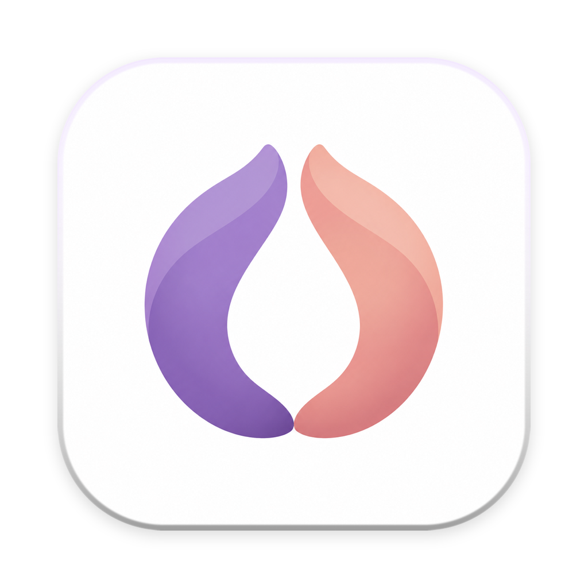
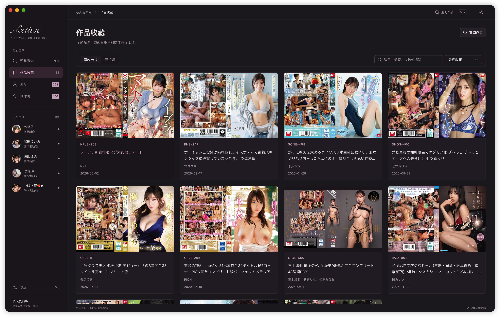
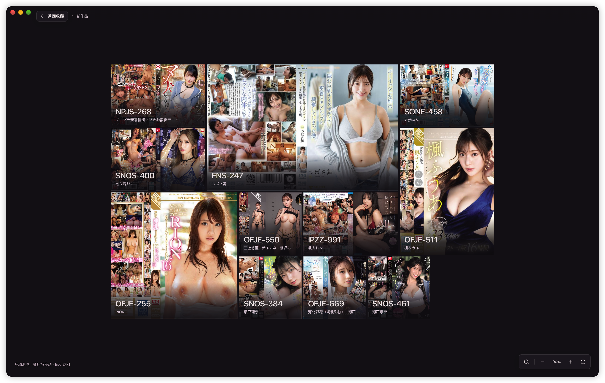
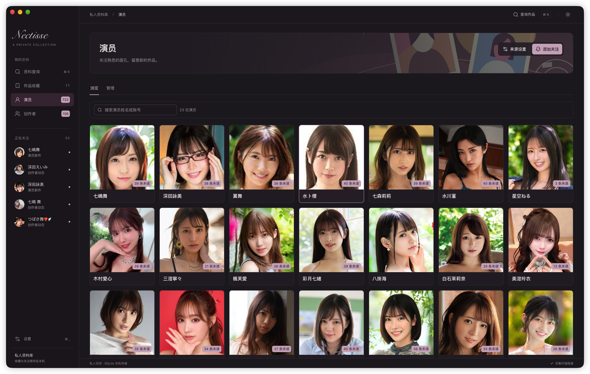
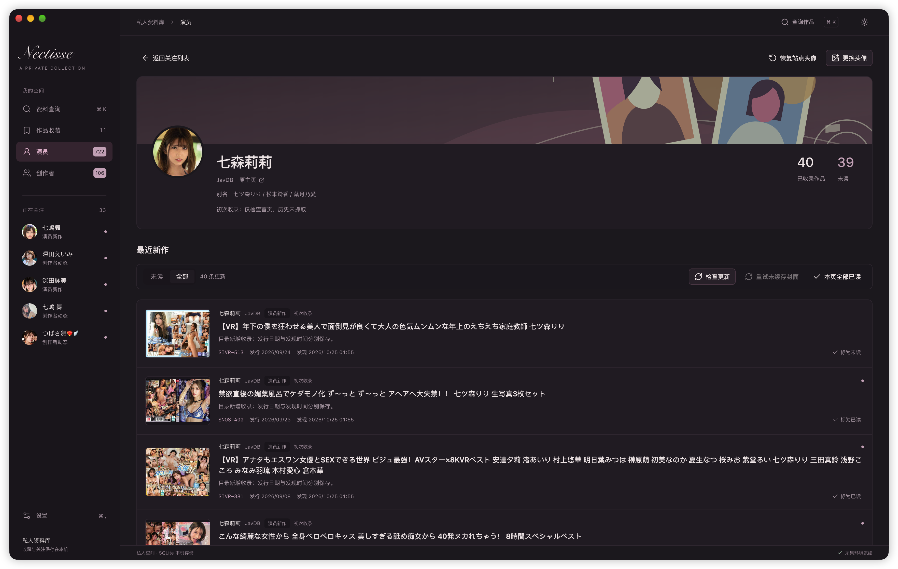
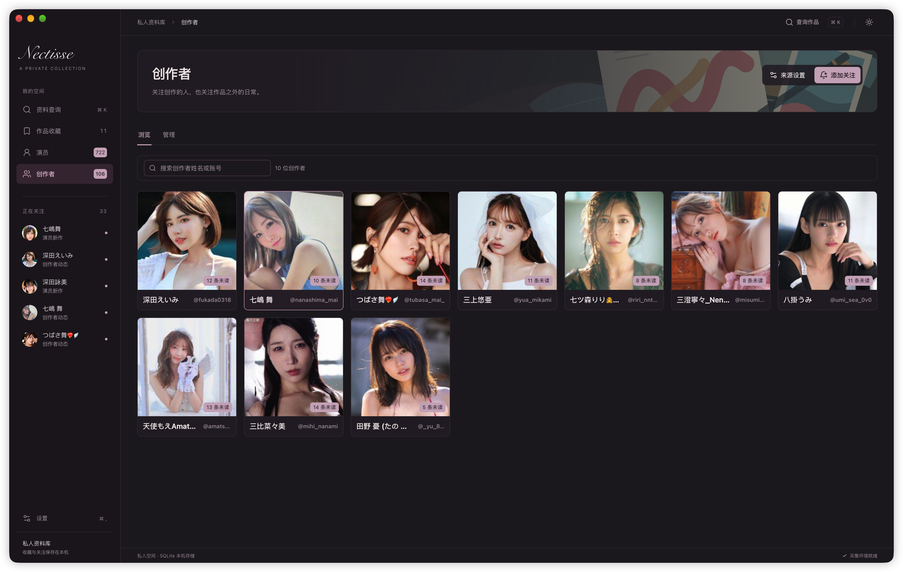
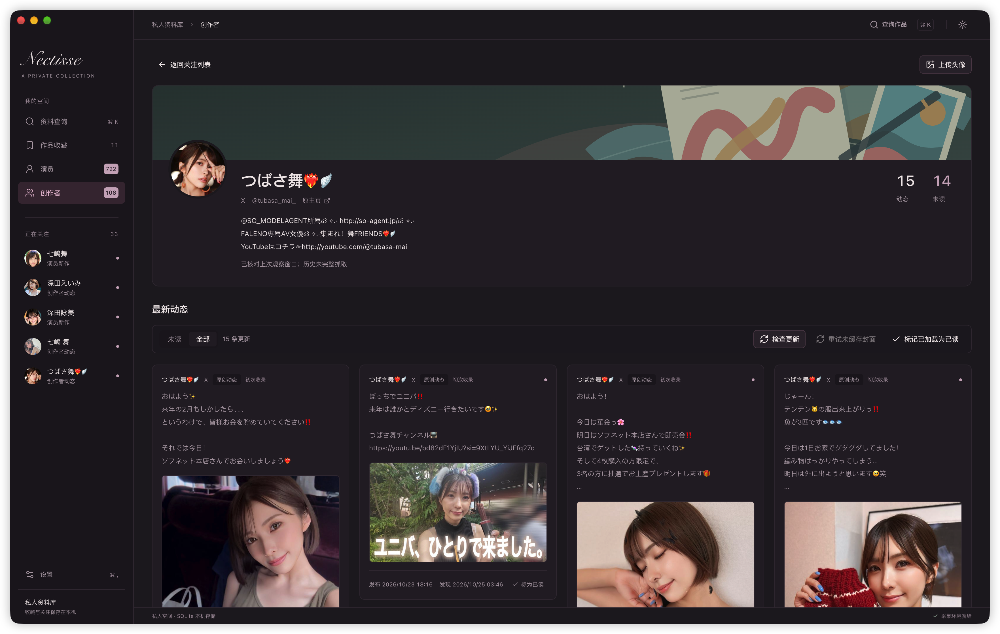
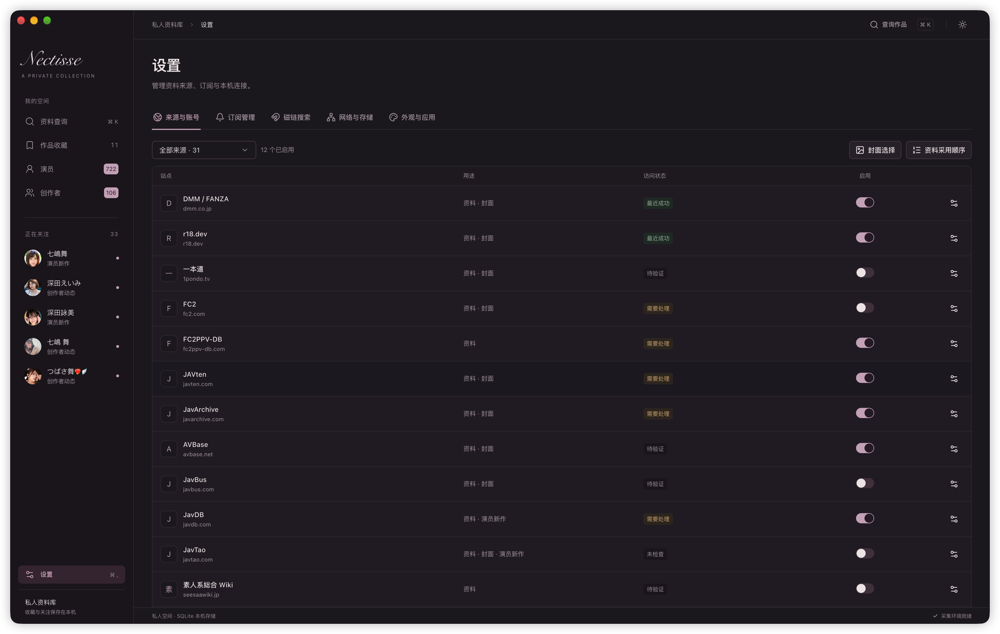

  
  <h1>Nectisse</h1>
  

    <a href="README.md"><strong>English</strong></a> · <a href="README.zh-CN.md">简体中文</a>
  

  
A private home for your collection and the creators you follow.

  

    <a href="https://github.com/nectisse/nectisse/releases/latest">Download for macOS</a> ·
    <a href="#screenshots">Screenshots</a> ·
    <a href="https://github.com/nectisse/nectisse/issues">Report an issue</a>
  

  
v0.2.2 · macOS 13.3+ · Apple Silicon (arm64)

Nectisse is a private collection and creator update app for macOS. Look up works, save their metadata and covers, browse your collection as a cover wall, and follow new releases and creator posts in one place.

A private collection workspace for macOS, built with Tauri and a Rust backend. No Node.js runtime is required.

## Download and install

Download a package from [GitHub Releases](https://github.com/nectisse/nectisse/releases), move `Nectisse.app` to **Applications**, and open it.

The app includes its Python runtime, dependencies, and collection scripts. No separate Python, Node.js, developer tools, or manually started background service is required.

## Features

- **Metadata and covers**: Search by work ID, title keywords, or a supported source URL. View titles, people, studios, series, release dates, tags, and descriptions, along with source links and retrieval times. Search methods and available fields vary by source.
- **Compare sources**: Compare metadata from multiple sources in a work's detail view. Configure metadata precedence and cover-source priority separately. DMM / FANZA covers are preferred by default, with one selected cover per work.
- **Your collection**: Save metadata and the selected full-resolution cover. Search by ID, title, people, studio, or tags, and sort by collection date, release date, or ID. After a new lookup, you decide whether to update an existing saved work.
- **Fullscreen cover wall**: Browse your collection as a collage of varied cover sizes with narrow gaps. Drag, zoom, and search; click to preview a full cover or open a work's details. Your browsing position is preserved when you return.
- **Follow performers and creators**: Look up identities, review candidates, and confirm follows in a dialog. Keep track of performer releases, creator announcements, and posts. Upload custom profile pictures or restore the source-provided image.
- **Updates**: Browse performer releases with pagination and creator posts in a masonry layout that adapts to image proportions, ordered by publication time. Filter unread items, mark them as read, check manually or on a schedule, and cancel active tasks.
- **Magnet search for a work**: Search Sukebei or JavTao from a work's detail view using its ID, with up to 20 results. Copy magnet links or open the original listing. An external shortcut opens Heima Cili for manual searches. The app does not provide playback or download tasks.
- **Personal settings**: Choose between Cream Archive and Blackberry Night themes. Manage sources, subscriptions, proxies, image storage, and diagnostic logs in Settings.

## Screenshots

**Your collection** — Browse saved works as cover cards, with search, sorting, and access to their full details.

Fullscreen cover wall

A cover collage you can drag, zoom, and click to explore.

Performers and new releases

Browse the performers you follow, then open a profile to see collected works, unread releases, and update status.

Creators and posts

Find followed creators by name or account, then browse their posts in an image-aware masonry layout.

Sources and accounts

Manage enabled sources and access status, with separate controls for cover priority and metadata precedence.

## Getting started

1. **Configure sources and connections.** Enable the sources you need in Settings. If connections fail, choose the system proxy, a direct connection, or a custom proxy in the network settings. Custom proxies support HTTP and SOCKS addresses.
2. **Look up and save a work.** Enter a work ID, keywords, or a source URL in the metadata search page. Open the result, review its details, and save it to your collection. Browse saved works as cards or in the fullscreen cover wall.
3. **Add a follow.** Open the performer or creator page and choose the add-follow action. Select a source, enter a performer name, creator URL, or site identity, then review and confirm the result in the dialog.
4. **Check for updates.** Check manually from a person's profile. To schedule checks, enable automatic checking in the subscription settings, then adjust the default or per-subscription frequency. Automatic checking is off by default.

Metadata search starts empty whenever you launch the app. Open previous results from query history when you need them. You can clear the current search and saved query history separately.

## Sources and access

| Purpose                           | Connected sources                                                                                                                        |
| --------------------------------- | ---------------------------------------------------------------------------------------------------------------------------------------- |
| Work metadata and covers          | DMM / FANZA, r18.dev, JavTao, AVBase, FC2, 1Pondo, selected studio websites, and other metadata sites. Fields and images vary by source. |
| Performer lookup and new releases | JavDB, JavTao                                                                                                                            |
| Creator posts                     | FANBOX, X, Patreon, Kemono, Pawchive, Coomer                                                                                             |
| Magnet links for a work           | Sukebei and JavTao; Heima Cili is available as an external website shortcut.                                                             |

The full source list, access status, and connection options are available in Settings. An integrated connector does not mean every site, work, or network location has been verified. Available content depends on the source response, account permissions, and network conditions.

- **X**: Uses FxEmbed to retrieve public posts authored by the account, without an X login. Replies, quotes, and reposts are excluded. The third-party service may return delayed or incomplete results.
- **JavDB**: Reads public metadata and performer catalogs. Some pages may require login or be restricted by region.
- **FC2PPV-DB**: Browser verification uses a separate session in a locally installed Chrome or Edge browser, which the app reuses afterward. This source provides metadata and people, but no covers. For other sources, refer to the verification options described in Settings.
- **Subscription coverage**: Checks use bounded incremental fetching; the covered range varies by source and check stage. Full history is not fetched automatically. Coverage notes appear on each profile. Newly discovered performer entries may already have been released; release dates and discovery times are stored separately.

## Local data and image cache

Your collection, follows, query history, post summaries, and read status are stored locally. Lookups and update checks contact the third-party sources you enable.

| Content                                   | Storage policy                                                                                                                 |
| ----------------------------------------- | ------------------------------------------------------------------------------------------------------------------------------ |
| Metadata, post summaries, and read status | Kept long-term, independent of ordinary image cache cleanup.                                                                   |
| Saved works                               | Metadata and the saved, selected full-resolution cover are retained for offline browsing.                                      |
| List and cover-wall images                | Lightweight thumbnails, prioritizing recent, unread, and frequently viewed images.                                             |
| Other full-resolution images              | Fetched on demand when opening details, within a size-limited cache.                                                           |
| Profile pictures                          | Kept with follows. Uploaded images are copied into the app's data directory, so moving the original file does not affect them. |

The ordinary image cache defaults to **512 MiB**. Adjust its limit or clear it manually in the network and storage settings. Collection storage and clearable cache usage are shown separately, and cleanup reports how much space was freed.

Expired images are refreshed when viewed; a failed refresh keeps the existing image. When space is needed, the app evicts full-resolution images that have not been viewed for a long time before older thumbnails. Identical images share files where possible. Missing images are fetched individually when viewed, without requiring a full work lookup or subscription refresh, provided the source is reachable.

User data is stored in `~/Library/Application Support/Nectisse/`, separately from the `.app` bundle. Quit the app before backing up the entire data directory.

## Background operation and support

Closing the window keeps the app running in the background. If automatic checking is enabled, subscription checks continue on schedule. Click the Dock icon to reopen the window, or press **⌘Q** to quit and stop background tasks.

For startup, local data, or source access issues, open the diagnostics section in the appearance and application settings to view and copy a report. Include your app version and reproduction steps when reporting an issue through [GitHub Issues](https://github.com/nectisse/nectisse/issues).

## Acknowledgments

Some site connectors, work identity matching, and cover-selection rules are adapted from [Peach](https://github.com/peach-mitao/peach), with additional metadata sources bridged through amane. The cover wall's rectangular collage templates are adapted via Peach from [Folia](https://github.com/chthollyphile/folia-major). Third-party licenses and attribution are included with the app.
